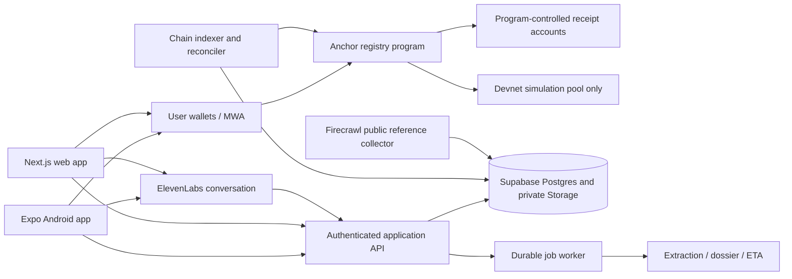

# Thetis system design

Proposed technical baseline · 18 November 2026

## 1. Product boundary

Implement the revised inland workflow: independently attested intake → lender lock and recorded advance → staged transport → arrival at the port stockyard → partial sale/release while Stored → loading and document hand-off, or joint stockyard redemption. Partial release is equally valid at the initial stockpile. No sale, ordinary split or redemption is allowed while any quantity is moving or reserved for a prepared shipment.

The registry proves its own state transitions. It does not independently prove lawful origin, accurate assays, possession, legal priority, absence of external pledges or bank settlement. Human attestations are attributable inputs with evidence and authority. The product exposes what was attested, by whom, when and against which document version.

The revised collateral-manager-led launch remains the product focus. The combined research's exporter-paid and enterprise-license hypotheses become configurable commercial arrangements, not two products or double-counted revenue. No fee model affects on-chain permissions.

## 2. Architecture



Logical deployment units:

- **Web:** Next.js role-based workspaces and server API. Never hold user transaction-signing keys.
- **Mobile:** Expo custom Android development build with Mobile Wallet Adapter integration; validate on actual phones, not merely Expo Go or a browser emulator. Mobile contains ordinary touch/type paths for all critical actions.
- **Program:** Anchor/Rust registry, permissioned positions, valuations, locks, confirmations and custody transitions. Token-2022 remains the proposed receipt technology, subject to a bypass spike.
- **Backend:** Supabase Auth, Postgres and private Storage. A separate durable worker performs indexing, reconciliation, extraction and scheduled computations; do not rely on short-lived web request processes for persistent jobs.
- **Integrations:** ElevenLabs for voice/text tools, Firecrawl for permitted public reference data; extraction provider and orchestration library selected using fixtures. Neither agent output nor reference scraping directly updates financial authority.

Suggested repository layout once scaffolded:

```text
apps/web/                    Next.js app and API
apps/mobile/                 Expo app
programs/thetis/             Anchor registry
packages/contracts/          schemas, units, generated program client
packages/domain/             deterministic display calculations
services/worker/             indexer, jobs, reports, ETA, reference collector
supabase/migrations/         tables, RLS and storage policies
fixtures/                    labelled synthetic evidence and scenarios
tests/scenarios/             cross-client/program lifecycle tests
(one verification command)   the single required local/CI implementation gate (build.md §1, item 7)
docs/                        specifications and decisions
```

Use TypeScript end-to-end off-chain and a shared schema package; do not select exact framework versions from memory. Pin a tested dependency set and lockfiles in phase 0. Program results are authoritative even when frontend validation agrees.

## 3. Authority and tenancy

An **Organisation** is the legal/operating entity; a **Member** is a person; an **Authority** is a wallet delegated a bounded role, scope and expiry. Login establishes the session, not lender or custodian rights. On-chain accreditation verifies mutation rights independently of the API.

- Custody rights are scoped to organisation, location/class and allowed activities.
- Lender rights are scoped to a lender organisation and its facilities/loans. A lender cannot overwrite another lender's valuation.
- Ownership positions identify the controlling owner organisation and its approved signing authorities; a service-role database write cannot manufacture ownership.
- Accreditation records known related-party declarations. It can refuse a declared borrower-related custodian but cannot discover undisclosed beneficial control automatically.
- Revocation blocks new risk-taking; defined recovery routes still permit debt repayment and transfer to an accredited replacement custodian.
- Admin key recovery changes authority only after the configured recovery process; it is logged and cannot silently transfer customer assets. Select multisig administration for any live deployment; devnet single-admin use must be disclosed.

Public chain state necessarily exposes accounts, quantities and lock relationships. Do not promise private lending balances if published on-chain. Keep names, bank records, contracts, pricing documents and personal identities in permissioned storage. Prefer salted commitments for guessable references; a plain hash of an invoice number does not make it secret.

## 4. Settlement isolation

Deploy separate protocol instances and data namespaces for `DEVNET_TOKEN_SIMULATION` and `FIAT_ATTESTATION_TEST`. A mode is immutable on an instance, recorded on every contract and response. Never switch a funded loan between adapters or mingle currencies in a pool. A future live fiat instance requires the commercial/legal/operational gates, not a hidden production toggle.

Both adapters invoke the same release invariants. In token simulation, checked token transfers, debt updates and receipt movement occur in one transaction. In fiat attestation, money arrives outside the chain; a lender attests it, and a later transaction atomically consumes that attestation and updates the registry. That second flow is not atomic bank settlement.

For phase 2, a facility and its loans have one immutable settlement currency. Payment and valuation currency must match; reference/display FX is never silently used to settle. Cross-currency payments require an explicit converted amount attested by the lender in the facility currency and private conversion evidence, or are rejected. No unrestricted FX oracle is added to the core.

## 5. Receipt enforcement

Proposed baseline: token accounts are controlled by program-derived authorities, with owner-specific program positions and explicit consent in every movement instruction. Users retain wallet authority over program actions, but cannot directly approve delegates, burn or transfer the underlying receipt outside the program. Token balances and positions must reconcile in the same transaction; no second mutable off-chain ownership ledger.

Phase 0 must prove direct Token-2022 transfer, burn, delegation, authority reassignment and close paths cannot bypass controls. A transfer hook alone is not assumed to guard every token instruction. If the proposed extension/account configuration cannot be proven, use the original project's allowed fallback: program-only claim positions and restricted mint custody. Record the result in an ADR before schema freeze. No free wallet receipt transfers are promised.

Minimise enabled extensions and validate token-program identity, mint, owners and configured authorities on every CPI. A non-transferable extension would also block ordinary token transfers; it is not an automatic solution for a transferable economic claim.

## 6. Availability and consistency

Distinguish `draft`, `awaiting signatures`, `submitted`, `confirmed`, `finalized`, `failed` and `outcome unknown`. Never convert a network timeout into success or automatically retry a value movement under a new identity. Reconcile original signature and relevant account revisions before rebuilding.

Views record chain slot, commitment and indexer freshness. Permit browsing with a visible stale-state label; fetch fresh state before proposing a mutation. The program enforces expected revisions so stale previews cannot authorise different effects. Indexer work is idempotent by network/program/signature/event index and periodically reconciles full account state.

> **Superseded in part (18 November 2026).** Multi-party approvals use signed intent messages submitted by the backend sponsor, not two signatures over one transaction or blockhash-expiry re-signing. See D23, D24 and D32 in the [decision register](docs/decisions.md). The text below is kept for reference.

Offline mobile capture may queue private draft evidence. It cannot complete chain custody or settlement. Co-signing needs two signatures over the identical transaction message, plus successful submission and confirmation. After blockhash expiry, both participants sign a rebuilt transaction; one old signature cannot carry over.

## 7. Technology evidence and phase-0 checks

Official sources consulted 18 November 2026:

- [Solana transfer hooks](https://solana.com/docs/tokens/extensions/transfer-hook) and [extension catalogue](https://solana.com/docs/tokens/extensions): inform the spike, not a guarantee of all-path enforcement.
- [Non-transferable extension](https://solana.com/docs/tokens/extensions/non-transferrable-tokens): changes transfer behavior; evaluate compatibility with intended program flows.
- [Solana Mobile Expo example](https://github.com/solana-mobile/expo-react-native-mwa-proof-of-concept): demonstrates a custom Expo development build. Treat it as an integration starting point; prove the chosen wallet's partial-signature behavior on real devices.
- [Supabase RLS](https://supabase.com/docs/guides/database/postgres/row-level-security) and [Storage access control](https://supabase.com/docs/guides/storage/security/access-control): implement access controls in addition to API checks; service credentials remain server-only.
- [ElevenLabs Agents overview](https://elevenlabs.io/docs/eleven-agents/overview/): lists React Native support; supported versions, microphone/session behavior and client tool callbacks still need a working spike.

No capability is marked shipped until the phase acceptance evidence exists.
