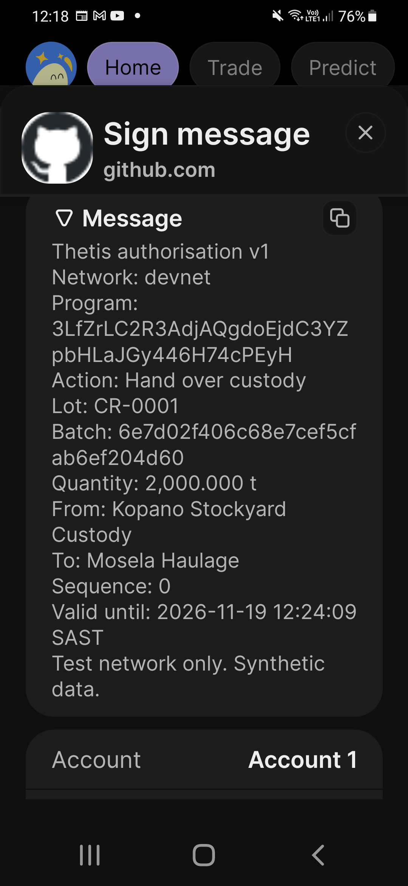
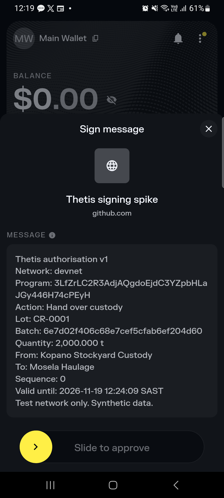
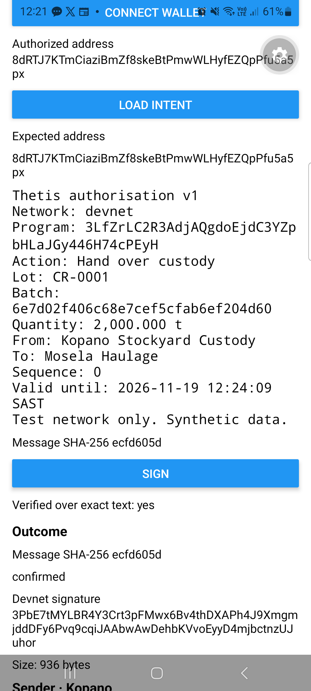

# ADR 0003: Parties sign a readable text; the program rebuilds it and checks the Ed25519 precompile

**Status:** accepted (19 November 2026): proven offline, on devnet and on the two phones · **Decision:**
D32 as re-decided on 18 November 2026 holds; both phone wallets displayed and signed the readable text, and the two-party handover is finalized on devnet; expiry moves from a slot to chain time ·
**Sources:** D23, D24, D32; [ADR 0002](0002-two-party-signing.md)

## Context

ADR 0002 showed that real wallets would not sign an Anza Programmatic Signer authorization
readably. Phantom blind-signed it behind an "unsafe" override, and Solflare refused it. The user
re-decided D32 as in-house verification:
- each party's wallet signs a plain-text intent with ordinary message signing;
- the sponsor submits a native Ed25519 verify instruction followed by the Thetis instruction;
- Thetis rebuilds the text from chain state and accepts only if the verify instruction checked
  exactly that text, for the registered wallets.

This ADR records the offline proof. The phone session adds its own section below.

## What was tested

`programs/intent-spike` (PR #16) is a spike, not the Thetis program. Its `handover` stands in for a
custody handover between two registered parties.

**The signed text** is twelve ASCII lines joined by `\n`:
- a title (`Thetis authorisation v1`);
- the network and the program id;
- the action;
- the lot and batch;
- the quantity in tonnes;
- both parties' display names;
- the sequence;
- `Valid until <time> SAST`;
- a test-network notice.

Display names (printable ASCII, single spaces) and lot ids (`A–Z 0–9 -`) are validated when
written, so a name can't add a line.

**The transaction** is `[Ed25519 verify (2 signatures, 1 shared message), handover]`. The sponsor
is the only signer and fee payer; there is no nonce account and no lookup table. `handover`
checks, in order:
1. it is a top-level call;
2. `now <= valid_until` and `valid_until − now <= 600 s`;
3. the expected sequence;
4. the quantity;
5. the batch is not already handed over;
6. the instruction immediately before it is the Ed25519 program's;
7. that instruction has exactly two entries, every offset index is `0xFFFF` (its own data), entry 0
   is the sender's wallet, entry 1 the receiver's, and both messages equal the rebuilt text byte for
   byte.

The runtime verifies both signatures before any program runs.

**Test setup:** LiteSVM 0.15 with its `precompiles` feature, so the real Ed25519 check runs. The
known-answer strings were computed in Python before the Rust existed.

## Results (`anchor build -p intent_spike && cargo test -p intent-spike -- --nocapture`)

```text
D32-inhouse honest handover: 936 bytes
D32-inhouse no verify instruction: refused (MissingVerification)
D32-inhouse verify instruction not adjacent: refused (MissingVerification)
D32-inhouse cross-instruction offsets: refused (CrossInstructionReference)
D32-inhouse sender signature only: refused (WrongSignatureCount)
D32-inhouse swapped signers: refused (WrongSigner)
D32-inhouse Mallory replaces receiver: refused (WrongSigner)
D32-inhouse sender signs twice: refused (WrongSigner)
D32-inhouse signed different quantity: refused (MessageMismatch)
D32-inhouse signed mainnet text: refused (MessageMismatch)
D32-inhouse signed for another program: refused (MessageMismatch)
D32-inhouse signed for another batch: refused (MessageMismatch)
D32-inhouse signed trailing byte: refused (MessageMismatch)
D32-inhouse sponsor extends signed expiry: refused (MessageMismatch)
D32-inhouse message changed after signing: refused (Ed25519 precompile)
D32-inhouse replay: refused (StaleSequence)
D32-inhouse expired: refused (Expired)
D32-inhouse window too long: refused (WindowTooLong)
D32-inhouse fake instructions sysvar: refused (ConstraintAddress)
D32-inhouse truncated verification: refused (Ed25519 precompile on chain; parser alone: MalformedVerification)
D32-inhouse invalid display name: refused (InvalidDisplayName)   (newline, non-ASCII, 49 bytes)
D32-inhouse invalid lot id: refused (InvalidLotId)               (lowercase, 17 bytes)
```

Four formatting tests also pass: tonnes and SAST known answers, and two full messages matched by
bytes, length and SHA-256. Every refusal asserts that the `Batch` account is byte-identical
afterwards. An independent review (PR #16) found no blockers. It confirmed that the bytes the
precompile verifies and the bytes the program compares can't diverge, because both are read from
the same instruction data at the same offsets.

## Decision

- **D32's in-house route holds offline** (LiteSVM with the real Ed25519 precompile; no devnet
  transaction has run it yet). Two readable signatures authorise one instruction. The
  sponsor alone signs and pays. The transaction is 936 bytes against the 1,232-byte limit,
  without a lookup table.
- **Expiry is chain time, not a slot.** The text says when it stops working in a form a person
  can read, and the program enforces a ceiling per action class (the spike implements only
  custody; money and the default are design ceilings for the real program):
  - custody: 600 s;
  - money: 300 s;
  - anything later: 600 s unless its catalogue row says otherwise.

  The relay is to set `valid_until` to the chain's current time plus the window, kept 30 s inside
  the ceiling so clock drift can't push it over, and never from a device clock (the relay change
  is built separately). D23 and D32 are amended to match.
- **The sequence is the replay guard.** A signature that was never used dies at its expiry.

## Limits and what is not proven

- **`NotTopLevel` is untested.** Refusing a call routed through another program would need a
  second, hostile program to test. It is defence in depth: the text and keys must still match, so
  wrapping the call gains nothing.
- **The verify-data parser's `MalformedVerification` path can't be reached through a transaction.**
  The precompile rejects truncated data first. The test checks the parser directly.
- **`register_party` and `open_batch` have no authority check.** That is spike scope; the real
  `Authority` record (D32 (1)) replaces `Party`.
- **The test harness carries an old Ed25519 library.** LiteSVM's `precompiles` feature brings
  `ed25519-dalek` 1.0.1 into the test graph only. Its advisories are accepted under #5 until
  2026-12-02.
- **Only two wallets, on Android, through Mobile Wallet Adapter, have signed the text.** Desktop
  browser wallets (D36) and Ledger are still to be checked.

## Phone session, 19 November 2026

**Setup:**
- **Program:** `intent_spike` on devnet at `3LfZrLC2R3AdjAQgdoEjdC3YZpbHLaJGy446H74cPEyH`, deployed
  the same day. The dumped bytes equal the local build. The sponsor is the upgrade authority.
- **Batch:** `DiNw8LXxJaEEAEZtSgJb3NgYjnFfXAxue9AkdQTch46X`, lot `CR-0001`, 2,000,000 kg, from
  `Kopano Stockyard Custody` to `Mosela Haulage`, registered for the two phone wallets.
- **Phones:** the Android test app (`apps/signing-spike`, #20) on the same two phones as ADR 0002,
  reaching the laptop relay (`intent-serve`) through `adb reverse`:
  - Galaxy A50, Android 11: **Phantom 26.38.1**, sender (`Vjh6…gcY`);
  - Galaxy A32, Android 13: **Solflare 2.33.2**, receiver (`8dRT…5px`).
- **The text:** both phones were given the same text (SHA-256 `ecfd605d…`), valid until 12:24:09
  SAST.

| Wallet | What it showed | Result |
|---|---|---|
| Phantom | The usual Connect sheet, with its "This app's identity could not be verified" banner (the app has no verified web domain). Then a plain **Sign message** sheet: the text in a collapsed card showing three lines; expanded, **all twelve lines** in full. No "unsafe" warning, no simulation error, no fee. | ✅ Signed; the relay verified it over the exact bytes. It took three attempts. First, an in-wallet "Update to the latest version" pop-up covered the request. Second, Phantom reloaded itself after Confirm and returned nothing. The third returned the signature 2 s after the request. |
| Solflare | **Sign message**, showing the app's name and **all twelve lines** in full, with "Slide to approve". No network-mismatch error, no fee. | ✅ Signed on the first attempt; the relay verified it over the exact bytes. |




**On chain:**
- **Transaction:** `[Ed25519 verify (2 signatures), handover]`, the sponsor as the only signer:
  `3PbE7tMYLBR4Y3Crt3pFMwx6Bv4thDXAPh4J9XmgmjddDFy6Pvq9cqiJAAbwAwDehbKVvoEyyD4mjbctnzUJuhor`.
- **Status:** `Ok`, **finalized** at slot 523959128; 936 bytes.
- **Fee:** 15,000 lamports (the transaction signature plus the two precompile signatures), paid by
  the sponsor. Both phone wallets still hold 0 SOL.
- **Batch afterwards:** `handed_over = true`, read back from devnet.

The app showed "Verified over exact text: yes", `confirmed` and the same signature.



**What this settles:**
- **D32 check (a), the one that failed in ADR 0002, now passes.** Both wallets show the intent as
  readable text. No warning in either asks a person to accept risk.
- **Both wallets sign the raw UTF-8 bytes**, with no off-chain-message envelope (design §10, D36).
  The relay's Ed25519 verify over the exact bytes passed for each.
- **The phones never sign a transaction or pay a fee** (D24).

**Practical notes for the demo:**
- **Phantom's own interruptions** (an update prompt, a reload) can swallow a request. The app must
  let a person tap Sign again, which it does, and the relay keeps the first verified signature
  per role.
- **The text has to be signed before the window closes** (here 9½ minutes). A fresh text is issued
  automatically after that.
- **Phantom labels the requester by its identity URI** (here github.com). A deployment uses the
  Thetis web domain with Digital Asset Links, which also removes the unverified-identity banner.

Raw evidence is kept locally in `.phone-sessions/2026-11-19/`: logcat, relay log, MWA timelines,
all screenshots, device and wallet versions read from the phones with `dumpsys`, the program's
upgrade authority, and the SHA-256 of the deployed and local builds, with SHA256SUMS. It is not
committed, because logcat is phone-wide and can hold device and account details.
