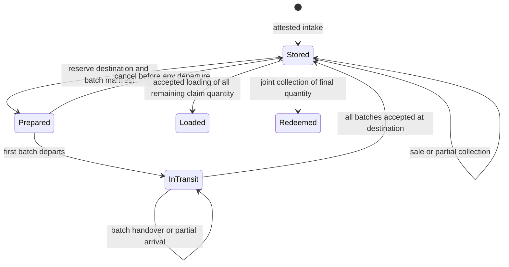

# Domain model and transaction contracts

Proposed implementation detail for the revised scope. Record names are logical; bound account vectors and transaction account counts in phase 0. Use indexed child accounts rather than unbounded arrays.

## 1. Identity, quantities and truth

An owner position represents entitlement within one lot. Physical custody batches describe where portions of that lot are held. A loan locks quantities in an owner position; changing physical custody does not change ownership or debt. Supabase holds searchable projections, not independent authoritative balances.

Amounts use nonnegative integer minor units; quantity uses an immutable class scale (for the mineral demo, kilograms as the atomic unit, tonnes for display). Each record includes unit/basis identifiers. Use checked wide intermediates for multiplication/division, explicit rounding and overflow refusal. Encode large integers as decimal strings in JSON; never through JavaScript `Number`.

Accounting conservation holds for claim quantities, separately from surveyed physical stock. If a shortage is confirmed, record observed shortfall and restrict release; do not quietly reduce owners' claims or debt to force a match. Apply a distinct authorised resolution with auditable allocation to claims.

For each position: `available = position_quantity − active_locked_quantity − separately_reserved_quantity`; reservations may overlap locked quantities only through a shipment explicitly referencing those allocations, never by subtracting them twice. A prepared shipment freezes its entire committed position quantity against sale/redeem. Each lock allocation refers to an exact position and amount, with aggregate locks not exceeding that position.

For storage: `occupied + reserved_inbound <= approved_capacity`. Splits at one site do not change total occupancy. Capacity counts physical registered mass; multiple representations of a parent/child must not count twice.

## 2. Logical records

| Record | Required content and identity |
|---|---|
| Protocol | Instance ID, network, immutable settlement mode, admin/accreditor authorities, bounded pause flags |
| Organisation / Authority | Organisation ID, accredited role/class/location, wallet, delegation expiry/revocation and relationship declarations |
| ClassPolicy | Versioned quantity unit/basis, grade catalogue, required-origin/document policies, tolerances and expiry rules |
| CustodianClass | Site/class capacity, occupancy, reservations, accredited entity and relationship declarations |
| IntakeIdentity | Persistent custodian-scoped intake digest, original lot and evidence commitment; never reusable after retirement |
| Lot | Root/parent lineage, grade, supply/claims, physical observations, expiry, custody aggregate, restriction state, revision |
| Position | Lot, owner organisation, claim quantity, active lock total; authoritative ownership mapped to controlled receipt account |
| Facility | Lender, borrower eligibility/policy, settlement currency, fixed terms version, private contract commitment |
| Loan / LockAllocation | Facility, borrower, debt components, accrual checkpoint/remainder; position and locked quantity; revision/status |
| Valuation | Lender/facility, class/grade/location/basis/currency, value per atomic unit, haircut, valid-until, source commitment, version |
| ReleaseIntent | Immutable seller/buyer/loan, sold quantity, price, top-up, currency, terms/revisions, expiry and nonce |
| PaymentAttestation | Lender, loan, currency, amount received, payment-identity commitment, purpose/intent digest, observed bank time, status |
| Shipment | Lot, destination, policy version, route, committed quantity, persistent reservation and status |
| ManifestBatch | Shipment, unique vehicle/consignment identifiers, immutable quantity, manifest version/commitment, current holder/stage and revision |
| Handover | Batch, sequence, previous/next authority, quantity, manifest digest, evidence commitment and chain time |
| DocumentAttestation | Kind, subject lot/shipment, issuer, version, original evidence commitment, validity/revocation and optional quantity allowance |
| LoadingIntent / HandoffAcceptance | Quantity/positions, document commitment, terminal/owner, every affected lender allocation, revisions and expiry |
| Incident / Resolution | Incident identity, observations, method/tolerance policy, affected lots, dispute status, decision authority and compensation |
| SimulationPool | Instance-bound test mint/vault, share accounting, liquid funds and separate recovery allocations |

PDA namespaces must include protocol instance. Reserve intake, payment, shipment-sequence and incident identities permanently or retain tombstones when closing data-heavy accounts. Recreating an account must not erase consumption history.

## 3. Independent state dimensions



`Prepared` is a shipment reservation state displayed as a restriction on a Stored lot; it is not a new physical location. Partly loaded quantities become a terminal child record; remaining quantity stays in a Stored parent. Keep a persistent relation between root and retired children.

Loans independently use `Active`, `Recovery`, `ExternalHandoff` and `Closed`. `Closed` requires zero recognised debt and no live collateral obligation. `ExternalHandoff` preserves outstanding debt and accepted external control references after receipt retirement. It does not mean debt was repaid or that legal security was independently verified.

Restrictions independently use `Normal`, `ReviewRequired`, `Disputed` and `Frozen`. Policy defines blocked risk-increasing actions. Repayment remains available. Movement out of a compromised custodian needs an explicit lender/owner/accreditor recovery route, not an unrestricted admin override.

## 4. Payment-confirmed partial release

1. Seller selects a Stored, uncommitted position and approved buyer, quantity and agreed amount. Backend computes a preview using fresh debt and lender valuation; seller signs immutable intent. Loan lender and buyer receive the exact intent digest. Terms include expiry and maximum authorised top-up.
2. Buyer pays through the existing bank workflow in the facility currency. The app does not claim to initiate banking. Lender confirms credited amount and links private bank evidence. One payment identity is unique across that lender/instance, not merely within one loan.
3. Lender signs an attestation bound to the intended action, loan, currency and immutable intent. Settled amount is a trusted assertion, not verified by a hash. Split payment allocation requires a recorded allocation ledger whose consumed sum cannot exceed the attested total; baseline instead requires one exact purpose-specific confirmation.
4. Execution requires seller/buyer approval, loan-lender authority via the attestation, fresh position and loan revisions, current policy/documents and valid valuation. Consume the confirmation and perform all registry changes atomically. An unrelated repayment confirmation cannot authorise selling someone else's collateral.
5. Reconcile and show debt change, buyer position and claim lineage only on confirmed chain state. Bank-received/chain-not-completed remains an actionable pending case. Expired intents must be re-authorised; existing payments are not silently reassigned.

Baseline accounting in one currency:

```text
D = principal + booked accrued interest + booked fees at execution
P = confirmed buyer amount + confirmed seller top-up
A = min(D, P)
D_after = D - A
Q_after = locked_quantity - sold_locked_quantity
require D_after <= floor(eligible_value(Q_after) * max_ltv_bps / 10000)
seller_surplus = P - A
```

Every minor unit has one purpose. In fiat mode the registry records allocation and any surplus obligation; it does not itself send the seller money. Top-up sources and refunds remain separately attributable so a top-up cannot accidentally create a seller payout. Treat excess/partial unmatched receipts as `Unallocated` outside release until lender and payer approve a bounded allocation. The baseline execution requires exact expected amount; overpayments follow that exception flow.

For the illustrative 5,000 t lot, valuation USD200/t, debt USD600,000 and 60% limit, a sale of 2,000 t for USD400,000 leaves debt USD200,000 on 3,000 t worth USD600,000 (33.33% LTV). No seller cash is released from that USD400,000. With a USD210,000 sale, debt would remain USD390,000, above the USD360,000 limit: require at least USD30,000 confirmed top-up or refuse. These are synthetic examples, not market prices.

Sale partitions economic receipt ownership and records physical allocation/lineage at the same location; it is not proof two piles have been physically separated. Separate-lot policy needs custodian-attested allocation before a child ships or redeems. No child gains a fresh assay/expiry automatically. Required documents must explicitly allow inheritance or receive new attestations.

## 5. Advances, accrual, repayment and correction

- Production-path `record_advance` records a lender attestation of actual funds advanced, currency and terms version. Borrower agreement fixes the maximum debt/rate before disbursement. An unsigned backend instruction cannot increase debt.
- Demo `borrow` executes the matching test-token transfer and book update under the same limits.
- Contractual basis, rate, fees and accrual convention are immutable by terms version. Initial deterministic simple-interest option uses actual elapsed seconds and a fixed 365-day denominator, carrying fractional remainder; production terms that differ must not be approximated silently. Loan updates materialise accrual to the execution time before calculating limits.
- Production repayment applies a purpose-bound payment attestation. Repayment is not blocked by stale valuation, loss of audio or owner login failure; an authorised payer/lender recovery flow remains available.
- Rate/fee changes need explicitly accepted amendments; do not retroactively reprice elapsed time.
- Attestation correction before consumption voids the unused record with a replacement link and reason. After consumption, append a dispute/correction record and restrict further releases; no rewind of buyer ownership, vanished debt or automatic clawback. Compensation is a separate authorised transaction and may require lender/legal resolution.
- A stale valuation blocks borrowing, sale/releases increasing exposure and liquidation; it never blocks reducing debt. Custody movement retains existing loan state subject to independently valid route/document policy.

## 6. Manifest batches and physical custody

> **Superseded in part (18 November 2026).** The two-party handover is approved by two signed intent messages that the program verifies, submitted by the sponsor (D23–D24 in the [decision register](decisions.md)). "One-transaction/two-signature" below now means one transaction carrying two verified party signatures. The QR carries the message or a retrieval ID, never authority.

One 5,000 t lot can require many vehicles. A stage name or a single phone scan cannot prove every vehicle arrived.

Prepare a shipment with bounded batches whose quantities sum exactly to committed quantity. A batch may cover one vehicle or a genuinely co-located consignment; its identity cannot overlap another batch's registered load identities. Physical identifiers still require human verification. Every batch has its own holder, route cursor and two-signer handover sequence. The UX groups these by route stage, matching the revised design without inventing one simultaneous whole-lot movement.

At first batch departure, aggregate lot becomes InTransit and ordinary sales/splits remain blocked for the **whole committed lot**. Source occupancy reduces only by departed quantities. At each accepted arrival, convert only that batch's destination reservation to occupancy. The remaining reservation persists until all batches arrive or an authorised diversion replaces it. When every batch is at the approved destination, aggregate lot returns to Stored and the shipment commitment clears. Missing or diverted batches are exceptions, not completed arrivals.

The demo may use one clearly labelled synthetic batch; production scaling tests must use several arriving at different times. Route checkpoints that do not take custody become observation events, not fabricated handovers. Transporter-to-terminal transfer is co-signed by actual authorised parties; a border observation can be signed by the observing role without claiming possession moved.

Every signing screen shows batch quantity, source/destination organisation, shipment, stage, manifest digest/revision and network. If QR payload exceeds practical size, QR contains a short-lived retrieval identifier; clients independently verify the fetched message, expected program/accounts and displayed intent before signing. QR is transport, never authority. Retain the one-transaction/two-signature design; no unilateral approval becomes a custody event.

## 7. Loading and stockyard collection

Loading is a separate exit from collection. Require Stored/uncommitted quantity, owner approval, terminal approval, loading evidence and accepted transport-document identity. Each active lender must sign a bounded acceptance covering its exact allocation, document digest, quantity, debt snapshot/terms, destination of control and expiry. New locks or changed documents invalidate an earlier acceptance.

On successful `record_loading`, atomically retire/burn the specified receipt units, reduce occupancy, create the immutable hand-off record and mark linked debt allocations `ExternalHandoff` if unpaid. Preserve loan balances, payment histories and consumed intake identities. Dashboard shows **“Registry retired; debt remains recorded; external hand-off accepted by lender”**, never “security guaranteed by bill of lading.” Zero debt instead allows ordinary loan closure.

Partial loading first partitions a Stored quantity into an explicitly identified child, with debt/collateral allocations accepted by the affected lender. Do not count a retired child against available stock or discard the parent's remaining debt. Reject ambiguous unallocated partial hand-offs in the initial implementation.

`redeem` applies to physical stockyard collection: holder + custodian sign, requested units are unlocked and uncommitted, valid collection ticket is bound, units burn and occupied capacity falls. Final collection ends the lot. A lender acknowledgment of sea hand-off is not a permission to bypass collection's repayment/unlock requirement.

## 8. Shortfall and recovery

Record observed versus expected quantity, method, timestamp, evidence and applicable policy version. Within-tolerance observations remain visible and cannot auto-slash; repeated patterns can trigger review. Method tolerances do not excuse false provenance, substitutions or assay discrepancies.

Incidents are uniquely namespaced; corrections preserve prior records. Restrict affected releases until a named authority resolves allocation, liability and compensation. Optional bond slashing is bounded by available bond and incident award, idempotent, and cannot pay the same loss twice. Surveyed inventory correction and compensation are different operations.

Liquidation changes control of locked receipt allocations to Recovery without teleporting ore or resetting shipment progress. Only received cash increases withdrawable simulation-pool liquidity; seized claims have separately reported quantity and valuation. Recovery sale waterfall and loss allocation must be specified/tested before lending capital is represented as live.

## 9. Required authorisations at a glance

| Operation | Required authority; key refusal |
|---|---|
| Issue | Independent accredited custodian plus required origin attestations; duplicate intake/over-capacity refused |
| Pledge | Owner + lender/facility acceptance; locked units unavailable to all other lenders |
| Advance | Accepted borrower terms + lender attestation or demo transfer; limit/currency/staleness checks |
| Transfer/split | Controlling owner; unlocked units, Stored, no shipment commitment, approved recipient |
| Partial pledged sale | Immutable seller/buyer intent + matching lender confirmation; atomically enforce residual health |
| Prepare/cancel | Controlling owner, lender route policy where required; cancellation only before any departure |
| Handover | Current batch holder + intended recipient; same message, next sequence, matching manifest |
| Document attestation | Accredited issuer for kind and scope; source version and validity bound |
| Loading | Owner + terminal + every affected lender acceptance; debt preserved when unpaid |
| Collection | Holder + custodian; no locked or committed requested units |
| Incident resolution | Named dispute authority under policy; inspector observation alone cannot invent a payout |

All handlers check program ownership, protocol instance, relationship seeds, signer scopes, units, expected revisions and arithmetic bounds. Backend authorization is additional defence, never a substitute.
