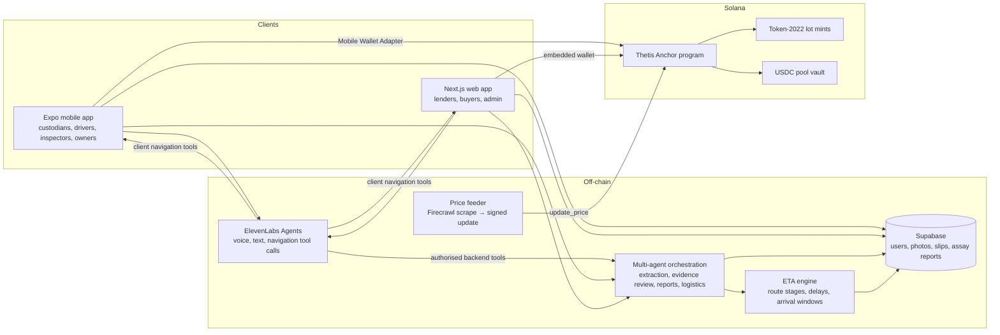
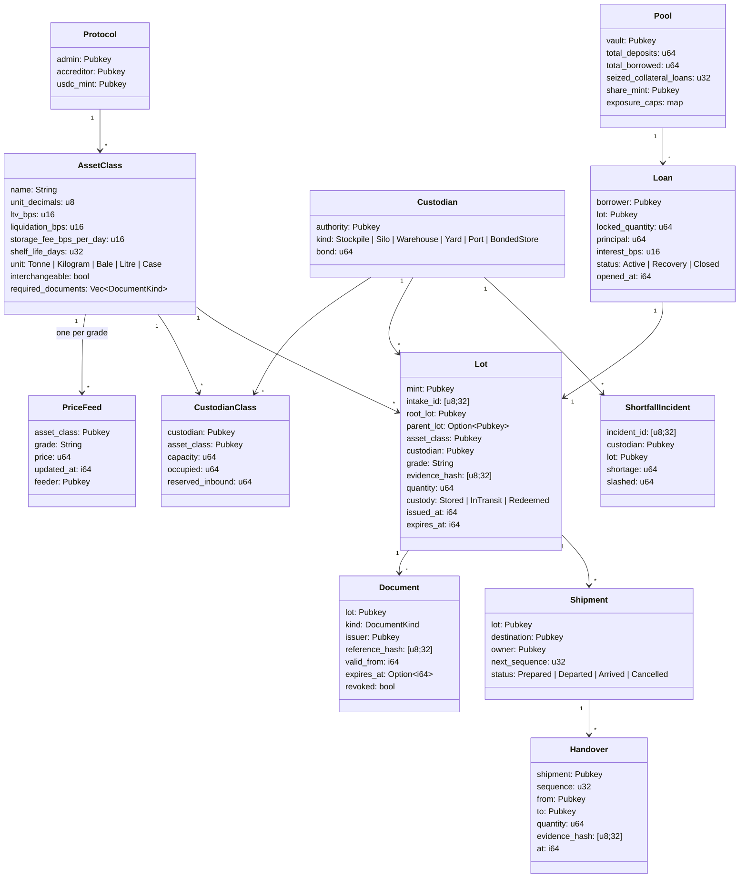
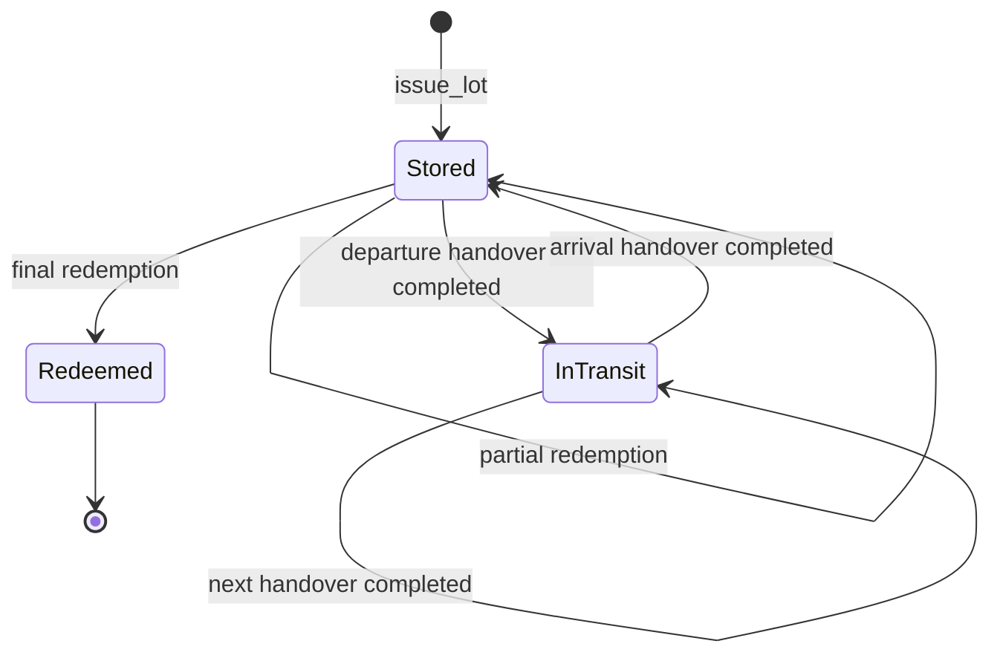

# Thetis — Project Document

**Dev3Pack Global Hackathon · 27–29 November 2026 · Solana**
Compiled 17 November 2026 · Working document
Companion reviews: [Cross-project enhancements](Thetis_Cross_Project_Enhancements.md) · [Design gap recommendations](Thetis_Design_Gap_Recommendations.md). This project document defines scope and takes precedence. Companion reviews provide rationale and options; only recommendations explicitly included here are committed. Any feature or phase completed and verified by the submission deadline is eligible for inclusion; no phase is reserved for after the hackathon.

> *Thetis changed shape until someone held on. We hold on to chrome through every form, from stockpile to token to ship to port.*

---

## 1. Summary

Thetis is a custody and finance layer for critical minerals in motion, built on Solana. It works for any bulk commodity corridor in the world; the pilot corridor is South African chrome ore to China, because it is one of the largest and most congested mineral export routes, and the team knows it first-hand. A custodian (a mine stockpile, a bonded yard or a port terminal) weighs and assays a lot and issues an on-chain receipt for it. The owner can sell all or part of the lot by transferring the receipt, or pledge it to borrow against. When the ore moves, the receipt moves with it: it changes to an in-transit state and every handover from yard to truck, border, rail and port is co-signed by both parties. The loan stays secured the whole way, and the receipt only burns when the buyer takes delivery.

The chain stays out of sight. Miners, custodians, hauliers and lenders work in their own currency inside a normal app; wallets sit behind the login.

## 2. The name

In Greek myth, Thetis was a sea nymph who changed shape again and again to escape Peleus. He held on through every form until she yielded. Ore does the same thing in Thetis: stockpile, token, truckload, shipload, delivery. The record never lets go.

Thetis also rescued Hephaestus, the smith god, and later asked him to forge Achilles' armour, which gives the name a link to metalwork. A search found no existing crypto project called Thetis. It sounds close to Theta Network, so say it clearly in the pitch.

## 3. The problem

### The global problem

Critical minerals cross the world from a few producing countries to a few processing ones, mostly in bulk and mostly by road, rail and sea, through ports that congest. While ore is in motion, its owner can't easily prove where it is, split it, or borrow against it, and custody records are scattered across mines, hauliers, borders and terminals. Buyers and regulators increasingly want to know where minerals came from and who held them along the way. *(Our framing; find sources for buyer and regulatory demand, such as due-diligence rules for battery and critical-mineral supply chains, before quoting specifics.)*

The same pattern repeats on other corridors. From memory, and to be verified: cobalt and copper from the DRC by truck to Dar es Salaam and Durban, nickel from Indonesia, and iron ore from Australia and Brazil.

### The pilot corridor: South African chrome

Chrome is used mainly in stainless steel. South African chrome ore is exported in very large volumes, mostly to China, through a congested transport system:

- China took a record 12.5 million tonnes of South African chrome ore in 2025, and 2026 flows are continuing at that pace.
- One industry estimate puts 2025 chrome ore exports at 23.4 million tonnes, about 9 million of them moved by truck.
- Congestion and underperformance on Transnet's rail network and at Richards Bay have pushed volumes toward the Maputo corridor through Komatipoort. A July 2026 report put delays at Richards Bay at around five days.
- Chrome ore exports now need a permit administered by ITAC as part of the government's push for local beneficiation.

The consequence this project addresses (our framing; not yet backed by a source): ore sits in stockpiles and queues for days or weeks between mine and ship. It is valuable but hard to verify, split or pledge while it moves, so the miner waits for the buyer's payment, and custody records are scattered across the mine, the haulier, the border and the port.

## 4. What Thetis does

| Feature | What it means |
|---|---|
| **Receipts** | A custodian issues a receipt for a weighed, assayed lot. The receipt carries asset class, grade, quantity, custodian and storage expiry. |
| **Duplicate and capacity checks** | Each recorded intake has an ID unique to its custodian, and that ID cannot issue receipts twice. This prevents reuse of a recorded intake; it does not independently detect the same physical delivery fraudulently registered under another ID. Separately, the program refuses to issue beyond the custodian's capacity for that asset class. |
| **Partial sale** | Quantity is the token amount, so selling 2,000 of 5,000 tonnes is a token transfer. |
| **Lending pool** | Lenders fund a USDC pool. Owners pledge receipts and borrow up to a loan-to-value limit set per asset class. |
| **Price-driven risk** | A price feed sets loan health. Falling prices trigger a margin warning, then liquidation that hands the receipt to the pool. |
| **In-transit custody** | The owner prepares a shipment, which reserves space at the destination. Custody moves only when both parties to a handover sign the same transaction, and the final handover into the port completes the arrival. |
| **Custodian bonds** | Custodians stake USDC. An inspector attesting a shortfall slashes the bond into the pool. |
| **Storage fees and expiry** | Fees accrue against the lot, and collateral value falls as it nears expiry. |
| **Document gates** | Each asset class lists the documents a shipment needs before it can move, such as an export permit for chrome or, for example, a phytosanitary certificate for grain. A shipment can't leave until they are attested. *The real contents of ITAC's chrome export permit need verifying before this is built.* |
| **Settlement on sale** | When part or all of a pledged lot is sold, the proceeds pay down the loan first, at least enough to keep what remains within its borrowing limit. The seller receives money only once the loan is fully repaid. Everything happens in one transaction. |

### Asset classes

Asset classes are configuration, not code. The demo uses two:

- **Chrome ore** (lead): lots identified by assay, so each lot is its own receipt.
- **Manganese ore:** a second class with different risk settings, to show the protocol is general.

Further classes (ferrochrome, cobalt, copper concentrate, nickel ore, other bulk commodities) are added by registering a new class, and further corridors by accrediting custodians along them. The pitch should show a second corridor on the map, even if only configured, to make clear this isn't a South African product.

### Receipt modes

The design supports two receipt modes. A mode is enabled only when its implementation and tests are complete; interchangeable stock is implemented in phase 6 and is eligible for submission if ready by the deadline:

- **Separate lots:** each lot keeps its identity and its own receipt, and redeeming returns that exact lot. For assets graded lot by lot: chrome and manganese (assay), wool and mohair (fibre test per sale lot), cotton bales, and wine in bond (vintage).
- **Interchangeable stock:** goods of one grade at one custodian are stored together, as grain is in a silo. There is one receipt mint per asset class, grade and custodian; a deposit mints more, and redeeming returns that quantity of the grade, not the original delivery. For maize, wheat, soya, sugar and cashews.

Livestock and fresh produce remain out of scope: animals move, die and aren't interchangeable, and fresh produce spoils too fast to serve as collateral.

## 5. Users

| User | Uses | Does |
|---|---|---|
| **Miner / ore owner** | Mobile and web | Holds receipts, sells, pledges, borrows, repays |
| **Custodian** (mine stockpile, bonded yard, port terminal) | Mobile | Weighs, assays and issues lots; co-signs arrivals and redemptions |
| **Haulier / driver** | Mobile | Co-signs handovers on collection and delivery |
| **Lender** | Web | Funds the pool, watches exposure by asset class |
| **Buyer / trader** | Web | Buys whole or part lots, redeems at the port |
| **Inspector** | Mobile | Attests shortfalls, which slashes custodian bonds |
| **Accreditor** (admin) | Web | Registers asset classes, accredits custodians and inspectors |

## 6. Architecture



- **Anchor program (Rust):** everything that moves value or custody.
- **Expo mobile app:** custodian intake, handover signing and inspection. This is the entry for the Seeker prize.
- **Next.js web app:** pool, lending, trading and admin.
- **Supabase:** users, roles, photos, weighbridge slips and assay reports. Hash the actual stored original, preserve it under an immutable identity, and bind each attestation to that identity and digest. Replacing a file cannot change evidence behind an existing attestation. Evidence access is restricted to authorised users; only hashes go on-chain. This baseline starts in phase 1; richer version history and photo metadata follow in phase 7.
- **ElevenLabs Agents API:** conversational voice/text interaction and tool-calling for platform navigation in web and mobile. Client tools open approved screens and populate drafts; backend tools retrieve authorised lot, shipment, document and loan information and dispatch supported agent jobs. This is a committed integration, not an optional voice-only feature.
- **Authentication:** the login, wallet-linking and session flow will be selected by the team. A login does not itself grant custody or inspector authority. Mobile Wallet Adapter and embedded wallets remain the proposed transaction-signing integrations; a custom challenge/nonce store is conditional on the chosen authentication flow.
- **Price feeder:** Firecrawl scrapes published chrome and manganese prices and posts signed updates. *Most chrome price indices are paywalled, so confirm a usable public source early; the fallback is an admin-signed feed for the demo.*
- **Money:** USDC held in integer minor units everywhere; each user's own currency shown in the interface at a quoted rate (rand for the pilot). No floating-point amounts in any layer.

### ElevenLabs conversational navigation and tool contracts

Users can speak or type requests such as “open my shipment to Maputo”, “show the missing documents for this lot”, “take me to repayment”, or “draft a delay report”. ElevenLabs Agents calls registered tools to perform navigation and fetch context, rather than merely describing where the user should click. Voice input also supports drafting delay observations and spoken explanations of verified status.

| Proposed tool | Execution | Behaviour |
|---|---|---|
| `navigate_to(screen, entity_id)` | Client | Opens an allowlisted screen/entity after checking access; no arbitrary URLs or code execution |
| `set_view_filters(view, filters)` | Client | Applies validated filters to shipment, lot or loan views |
| `prepare_form(form, entity_id, fields)` | Client | Opens a supported form with clearly marked draft values; never submits an attestation or transaction |
| `get_lot_summary(lot_id)` / `get_shipment_status(shipment_id)` | Backend | Returns authorised current state, evidence references and freshness timestamps |
| `get_document_requirements(lot_id)` / `get_loan_status(loan_id)` | Backend | Returns deterministic requirements, missing items and calculated debt/health for explanation |
| `request_analysis(entity_id, analysis_kind)` | Backend | Dispatches an authorised extraction, dossier or logistics job and returns its job ID/status |

These are Thetis tool contracts to implement, not built-in ElevenLabs tool names. Data-access restrictions apply to sensitive information, not to ordinary platform navigation or public information. Opening public screens, changing view filters and explaining public platform features need no extra approval. Opening a protected screen uses the normal application session; it does not automatically send the screen's sensitive contents to ElevenLabs.

Sensitive information includes personal identifiers, private evidence files, confidential commercial terms, non-public loan details and restricted shipment information. Before a tool returns such information to the conversation, the backend validates the user's session, entity permissions and the platform's external-processing policy independently of model-supplied arguments. Return only necessary permitted fields; redact or omit the rest. If a field cannot be shared with ElevenLabs, the agent can navigate the user to its authorised in-app view without receiving that field. Do not require repeated approval for access already authorised under the selected policy.

Public on-chain facts may be retrieved as public information, but linking them to a private person's identity or commercial records can produce sensitive information. Provider credentials and wallet secrets are never conversation context. These are Thetis data-handling rules; they are not a claim about ElevenLabs contractual restrictions. Conversation retention, external-processing permissions and treatment of sensitive user speech/text remain explicit implementation decisions.

Navigation and permitted read-only lookups execute on request without an extra approval step. Transaction authority is a separate control from data sensitivity. Ambiguous entity names prompt clarification. Drafts are reviewed before saving; financial actions and custody/document attestations still use the normal authorised UI and required wallet signatures. Spoken approval is not a wallet signature. Tool failures are reported honestly, and the agent confirms navigation only after the client reports success. Cancelling a conversation cancels neither a confirmed chain action nor an independently running job.

Keep ordinary touch/type navigation available if audio or the agent service is unavailable. Test the browser and Expo client integrations early, including microphone permissions, session expiry, interrupted speech and expired authentication. Conversation retention and access policy must be decided with the authentication design.

The official [ElevenLabs tool overview](https://elevenlabs.io/docs/eleven-agents/customization/tools) distinguishes client-side tools from backend webhook tools; [client tools](https://elevenlabs.io/docs/eleven-agents/customization/tools/client-tools) provide the integration point for application navigation. Thetis supplies the routes, permission checks and business logic.

### AI assistance, report versions and ETA

AI document extraction proposes quantity, grade, unit, date and document-reference fields with page/image evidence. Deterministic schema, unit and evidence checks validate proposals; uncertain readings go to a named human reviewer. Only an accredited human can attest the result. Manual intake remains available.

The multi-agent orchestrator routes work among extraction, evidence verification, dossier drafting and logistics explanation agents. Each result carries source references, validation status and reasons. Retries and run budgets are bounded; exhausted or conflicting results stop for review. Agents have no signing keys or authority to issue receipts, approve attestations, release collateral or move custody. ElevenLabs Agents is the selected conversational entry point with tool-calling. The extraction models and backend orchestration framework remain open implementation choices; they must connect through explicit tool contracts rather than duplicate the conversational layer.

Full report versioning binds each lot dossier to a canonical snapshot of evidence versions and authoritative custody/finance records. Every published version retains its manifest, hash, generation time and review status. Changed inputs mark older reports as superseded or stale; they remain retrievable rather than being overwritten. Reports distinguish extracted claims, human attestations and confirmed chain events.

The ETA engine combines the last confirmed handover, route stage, historical travel/dwell baselines and observed delays into arrival windows with uncertainty and input timestamps. Forecasts update as observations arrive; missing or stale inputs are visibly degraded or unavailable. The logistics agent explains the calculated forecast and cites its inputs; it does not invent locations or override the engine. Delays trigger alerts, never automatic shortfall findings or slashing. Advanced forecasting does not imply permission to reroute an active shipment.

## 7. On-chain design

### Accounts



### Lot lifecycle

Custody (where the ore physically is) and financing (whether it secures a loan) are tracked separately. This is the custody lifecycle:



Financing lives on the loan: active, in recovery, or closed. Pledging, repaying and liquidating never change where the ore is. Liquidating a shipment mid-transit hands the locked units to the pool while the shipment carries on.

Rules the program enforces:
- Ordinary transfers and physical splits use only units owned by the caller and not locked as collateral. A physical split conserves quantity and preserves root/parent lineage, grade, expiry and evidence provenance. `sell_pledged` is the explicit atomic exception: it collects proceeds/top-up, pays debt, checks residual collateral, releases the sold units and creates the buyer's unencumbered child lot.
- The owner preparing a shipment must control the whole shipment lot, including any units locked for that owner's loan. Another holder's units cannot be included; split separately owned quantities before preparing independent shipments. A prepared shipment reserves its quantity against conflicting transfer/split operations until cancellation or departure.
- Required documents must match the lot and kind, have an authorised issuer, be within their validity period where applicable, and not be revoked. Check these at preparation and again at departure. Initially each child lot requires a fresh attestation; phase 5 adds explicit policy-controlled allowance sharing.
- A loan locks an exact quantity of receipt units, so a holder can only pledge their own units and the same units can't secure two loans.
- Pledged units can be shipped, but can't be redeemed until the loan is repaid or settled from a sale.
- A handover is one instruction that both the current holder and the next party must sign. Handovers happen in person, so one phone builds the transaction, shows it as a QR code, and the other phone checks the details, adds its signature and submits. Both parties sign the same bytes, so they can't approve different details, and one signature alone never moves custody. A recent-blockhash transaction has a short validity window rather than a guaranteed wall-clock duration. If it expires, check the prior transaction outcome, rebuild it, and have both parties sign the new transaction again. No pending or partly approved state is stored on-chain.
- Intake identity is namespaced by custodian and intake ID; a handover by shipment and sequence; a shortfall by custodian and incident ID. Account creation and current-sequence checks prevent duplicate effects without a generic operation account. Preserve consumed identities after redemption or resolution so closing a record cannot permit reuse. Child lots use parent-scoped split identities and retain the original intake provenance. After a timeout, clients reconcile the transaction and account state before rebuilding; repeated mutations must satisfy their domain-specific state checks.
- Seized collateral is not cash. When a loan is liquidated, the pool holds the locked units in recovery, and the pool's withdrawable value counts only USDC until the ore is sold.
- A stale or wrong-grade price blocks borrowing, releasing collateral and liquidation, but never blocks repayment or custody movements.
- Redemption needs both the receipt holder's approval and the custodian's acknowledgement; neither can redeem alone.
- A redeemed lot's receipt is burned, so it can't be pledged after the ore has left.
- For an interchangeable class, the Lot account is the custodian's stock of one grade, and its supply can never exceed what the custodian holds of that grade. Shipping part of it first splits off a separate lot, which then travels on its own receipt.

### Shipment from mine to port

```mermaid
sequenceDiagram
    participant O as Ore owner
    participant C as Mine stockpile (custodian)
    participant D as Haulier
    participant B as Border / rail
    participant P as Port terminal (custodian)
    participant T as Thetis program
    O->>T: prepare_shipment(lot, route, destination = P)
    T-->>T: check owner control and valid lot documents, reserve capacity at P
    C->>D: handover 1 transaction, signed by C (QR)
    D->>T: handover 1, signed by C and D
    T-->>T: recheck documents; custody moves to D, lot InTransit
    D->>B: handover 2 transaction, signed by D (QR)
    B->>T: handover 2, signed by D and B
    B->>P: handover 3 transaction, signed by B (QR)
    P->>T: handover 3, signed by B and P
    T-->>O: lot Stored at port, reservation used, loan still secured
```

### Instructions

| Group | Instruction | Refused when |
|---|---|---|
| Setup | `register_class` | signer isn't the accreditor; invalid risk settings |
| | `accredit_custodian` | signer isn't the accreditor; asset class not allowed |
| | `post_bond` / `withdraw_bond` | withdrawal would leave the bond below required cover |
| | `register_feed` | signer isn't the accreditor; a feed for that class and grade already exists |
| Receipts | `issue_lot` | intake ID already used at this custodian; over the custodian's capacity for the class; custodian not accredited for the class; bond too small; no price feed for the grade |
| | `transfer` / `split` | caller does not own the requested units; requested units locked; lot in transit or committed to a prepared shipment; recipient not approved |
| | `redeem` | units pledged; lot not Stored; missing the holder's approval or the custodian's acknowledgement |
| Lending | `deposit` / `withdraw` | withdrawal exceeds free liquidity |
| | `pledge` | units not owned by the borrower or already locked; lot expired or near expiry; class exposure cap reached |
| | `borrow` | over the loan-to-value limit; stale price |
| | `repay` | wrong loan or wrong lot |
| | `accrue_fees` | none; callable by anyone |
| | `liquidate` | loan still healthy; stale price |
| | `sell_pledged` (atomic debt payment and child-lot split) | seller does not control the sold collateral; lot in transit or committed to a prepared shipment; buyer not approved; proceeds (plus any seller top-up) don't bring the remaining loan within its borrowing limit; stale price |
| Custody | `prepare_shipment` | signer does not control the whole shipment lot; lot already committed to a shipment; required document missing, invalid, revoked or for another lot; lot not Stored; no spare capacity at the destination; interchangeable stock not yet split into a lot |
| | `handover` (two signers) | either signer isn't the current holder or the next party; lot not in an active shipment; sequence number out of order; departure documents no longer valid; final recipient isn't the reserved destination |
| | `cancel_shipment` | goods have already left the first custodian |
| | `attest_document` | signer isn't accredited to issue that kind of document; subject lot or stored evidence invalid; validity interval invalid |
| | `revoke_document` | signer is neither the issuing authority nor the authorised accreditor |
| Enforcement | `attest_shortfall` | signer isn't an accredited inspector; incident ID already recorded; slash would exceed the bond |
| | `update_price` | signer isn't the feeder; timestamp older than the current one |

## 8. Demo (two minutes)

1. **Open on the problem:** a world map of critical-mineral corridors, then zoom into the pilot: a chrome mine through Komatipoort to Maputo and on to China, with the 2025 export figures.
2. **Issue:** on the custodian's phone, a 5,000-tonne chrome lot is weighed, its assay photographed, and a receipt issued.
3. **Borrow:** the owner pledges the lot and the loan lands, shown in rand.
4. **Sell part:** a trader buys 2,000 tonnes. The proceeds pay down the loan in the same transaction, and the trader's 2,000 tonnes split off as their own unencumbered lot.
5. **Ship:** the owner ships the remaining 3,000 tonnes, still financed. At each handover two phones meet: one shows a QR code, the other scans and signs, and the handover appears live.
6. **Risk:** a clearly labelled demo price drop pushes the loan past its warning threshold, with the calculated figure on screen.
7. **Arrive and redeem:** the port takes custody, the owner repays the rest of the loan, and the owner and port together redeem the lot. The receipt burns.
8. **Close on refusals:** try to receipt the same delivery twice with a reused intake ID, then try a handover approved by the wrong driver. The program rejects both.

When the ElevenLabs integration is ready, use “open my shipment” to navigate during step 5 and a tool-backed explanation in step 6. A voice-drafted delay report can be shown in the extended walkthrough; distinguish the reported observation from a confirmed custody event.

## 9. Testing

The target is more than 200 tests, beating the 168 in the main rival's last winning entry.

- **Program tests:** for each instruction, one success case and every refusal path in the table in section 7.
- **Lifecycle tests:** full journeys through the state diagram, including ship-while-pledged and liquidation mid-transit.
- **Money tests:** interest and fee accrual at integer precision, with no rounding that creates or loses USDC.
- **Mode tests:** required before enabling interchangeable stock or presenting it as working: deposit into shared stock, partial redemption, and splitting a lot off before shipping.
- **App tests:** the key mobile and web flows, including fresh signatures after transaction expiry and reconciliation after timeouts.
- **Evidence and document tests:** stored-original integrity, private access, expired/revoked/wrong-lot documents, departure rechecks and child-lot attestations.
- **Agent tests:** grounded extraction on labelled fixtures, unit/decimal/date errors, uncertain-reading escalation, bounded retries and denied attempts to attest or execute transactions.
- **ElevenLabs tool tests:** voice and text navigation without unnecessary approval, public-data lookup, protected-screen navigation without disclosure to the agent, sensitive-field redaction and external-processing checks, valid/invalid routes, ambiguous entity names, cross-user access denial, session expiry, backend failure, repeated job requests, draft-only form population and unavailable-audio fallback. Confirm the agent cannot invoke signing or attestation tools.
- **Report tests:** stable snapshot hashes, stale-report detection after corrections, immutable previous versions and authorised historical retrieval.
- **ETA tests:** historical replay, forecast error and interval coverage, late/out-of-order observations, stale inputs and truthful unavailable estimates. These tests gate activation of the corresponding phase.

Put the test count on the submission page.

## 10. Build phases

Thetis is built in the phases below, in order. Each phase ends with its tests passing. How the phases map onto the calendar is the team's decision. Any feature or phase completed, integrated and verified by the submission deadline can go into the submission. There is no fixed phase cutoff and no automatic post-hackathon deferral. Unfinished capabilities remain disabled and are described as planned, not working.

| Phase | Work | Done when |
|---|---|---|
| **0. Foundations** | Refine the section 7 diagrams. Check the hackathon rules (team size, open source, earlier code). Scaffold the repository with one shared types package for web and mobile, keeping large on-chain numbers intact across the apps (FrameFlow's approach). Add UbuntuRemit's single verification gate: the same command runs required program and app checks locally and in CI, and fails when a required check cannot run. Run the token restriction spike. Confirm a chrome price source. Start a claim ledger: every claim in the pitch with its source (Harvest's approach). | The spike proves receipts can't be moved, burned or delegated around the program, or the program-controlled fallback is chosen; the shared verification gate runs successfully |
| **1. Receipts** | Asset classes, custodians, bonds, accreditation, intake IDs, capacity (occupied and reserved), lots, transfer, split with lineage, redemption by holder and custodian together; stored-original hashing, immutable evidence identity and private access. | Duplicate intake, over-capacity, wrong-owner and single-party redemption are refused; replacement files cannot alter attested evidence |
| **2. Lending** | Pool with lender shares, loans that lock exact quantities, price feeds per grade with staleness rules, demo prices clearly labelled as such (Horus's approach), storage fees and expiry, borrowing, repayment, debt-first partial sales, liquidation into pool recovery. | Integer accounting balances, and seized ore never counts as withdrawable cash |
| **3. Custody in motion** | Shipment preparation with destination reservation, required-document gates with lot/issuer/validity/revocation checks at preparation and departure, fresh child-lot attestations, two-signer handovers, arrival into the destination custodian, cancellation before departure, shortfall incidents with one-time bond slashing. | A pledged lot ships and arrives without losing its loan; wrong-party, out-of-order and repeated handovers are refused |
| **4. Apps and demo** | Expo mobile app (intake, QR handovers, inspection), Next.js web app (pool, lending, trading, admin), price feeder, ElevenLabs conversational navigation with client tools and authorised status lookups, voice-drafted delay reports, seeded demo data that includes deliberate failure cases (Mothusi's approach), demo video, submission page. | A fresh environment reproduces the section 8 demo and its refusals; voice/text requests navigate to the correct authorised screen and tool failures are visible |
| **5. Hardening** | Versioned document policies with quantity allowances shared across split lots; route changes after departure; shortfall disputes with a named resolution authority; bond cover divided per asset class; the payout order after a recovery sale (costs, debt, then the former owner). | Each rule has success and refusal tests |
| **6. Interchangeable stock** | Shared receipt mint per class, grade and custodian; stock tracked by intake date with earliest-expiry-first withdrawals, so new deposits never extend old stock's expiry; splitting a lot off before shipping and merging on arrival with recorded lineage. | Quantity is conserved across deposit, split, merge and redemption |
| **7. Evidence and full report versioning** | Evidence revision history and photo-metadata handling (Tokelo's approach); full versioned lot dossiers with source manifests, content/state hashes, immutable prior versions, supersession and stale-report detection (Aethel's approach). | Corrections produce a new traceable version, stale reports are identified, and authorised users can retrieve prior versions in both apps |
| **8. AI document extraction and multi-agent orchestration** | Extract assay, weighbridge and shipment-document fields with source references (Mothusi/Panelwise); orchestrate extraction, evidence verification, dossier drafting and logistics explanation agents behind deterministic entry/exit gates (UbuntuRemit), exposing supported jobs through ElevenLabs backend tools. | Labelled fixtures measure field accuracy; unsupported claims and uncertain readings reach review; bounded retries terminate; agents cannot attest, sign or move value |
| **9. Advanced ETA and logistics** | Route-stage arrival windows, observed delay events, historical travel/dwell baselines, uncertainty estimates, overdue alerts and forecast updates (LogisticsConnect); integrate forecasts with the logistics agent and lender/owner views. | Forecasts distinguish observed facts from estimates, expose source freshness, and are evaluated against recorded journeys; stale/missing inputs yield an explicit degraded or unavailable estimate |

## 11. Positioning

**Prizes and sponsors:**
- **Best App Overall:** depth of the program and a complete custody story.
- **Best Mobile App (Seeker phones):** custodians, drivers and inspectors work on phones with Mobile Wallet Adapter.
- **Firecrawl:** price feeds. **Supabase:** off-chain records.
- **ElevenLabs:** Agents API for voice/text conversation, client-tool platform navigation, authorised backend lookups and orchestration requests. Demonstrate “open my shipment”, a tool-backed document/status explanation, and a reviewed voice-drafted delay report. Agents cannot sign or bypass the platform's transaction and attestation controls.

**Competing internationally.** Best App Overall is judged across 380+ projects from around 89 countries, so the pitch is a global one: a custody layer for critical minerals, with South Africa as the proving ground. Lead with world supply chains in the first sentence, and keep the local detail (Komatipoort, Transnet, ITAC) as evidence the team understands a real corridor deeply.

**The main rival** won South Africa's top place last edition with agri-finance for smallholders (credit, inputs and rainfall-triggered insurance, with the chain invisible; Anchor, Next.js, Supabase, 168 tests), and has since won W3Node with Heirloom, an on-chain estate executor. Thetis stays out of both areas by leading with minerals and logistics, and matches his bar on hidden chain, local-currency interface and test count.

## 12. Open items

- **Team size and roles:** with three people, split Rust, mobile and web; with two, one person takes the program and the other both apps.
- **Hackathon rules:** check the FAQ for team size, open-source requirements and whether earlier code is allowed.
- **Repository location:** not yet decided.
- **Authentication flow:** select login, wallet linking, session storage and recovery; decide whether a custom signature challenge and shared nonce store are needed. Do not assume DropZone's implementation is required.
- **AI implementation:** ElevenLabs Agents is selected for the conversational/API tool-calling layer. Choose extraction models and backend orchestration framework after evaluating fixtures, latency and cost; define tool schemas, job deduplication, authenticated session binding and permissions before implementation.
- **ElevenLabs client integration:** validate web and Expo support, microphone/session handling, private agent access and conversation retention. Confirm the chosen plan supports the intended usage and record integration limits.
- **ETA inputs:** identify usable route, journey and delay data; label synthetic fixtures and do not present unvalidated forecasts as measured performance.
- **Chrome price source:** most indices are paywalled; confirm a public one or plan an admin-signed feed.
- **ITAC export permit:** confirm what a permit contains before modelling the permit gate.
- **Token restriction spike:** before fixing the account layout, prove that receipt tokens can't be transferred, burned or delegated around the program's rules by calling the token program directly. If Token-2022's features can't guarantee that, keep receipts under program control and drop free wallet transfers.
- **Price feeds for other assets:** grain and wool are priced per grade, so switching needs a feed per grade (for example published maize futures and wool auction results). Sources not yet confirmed.
- **Unsourced claims:** that logistics delays tie up miners' working capital, that buyers and regulators want custody records for critical minerals, and the other corridors named in section 3. Find sources or present them as our framing.

## Sources

- [SMM Analysis: South Africa's Chrome Ore and High-Carbon Ferrochrome Exports](https://news.metal.com/newscontent/103989945-smm-analysis-south-africas-chrome-ore-and-high-carbon-ferrochrome-exports)
- [Durban's Global Praise Meets Ground Reality: Congestion and Corridor Bottlenecks Still Cloud SA's Chrome Export Routes (SMM)](https://news.metal.com/en/newscontent/104018797-durbans-global-praise-meets-ground-reality-congestion-and-corridor-bottlenecks-still-cloud-sas-chrome-export-routes)
- [Logistics pressures are reshaping chrome export patterns (Project Blue)](https://projectblue.com/blue/news-analysis/1277/logistics-pressures-are-reshaping-chrome-export-patterns)
- [Manganese, chrome industries seek answers to South Africa's transport network woes (Fastmarkets)](https://www.fastmarkets.com/insights/manganese-chrome-industries-seek-answers-to-south-africas-transport-network-woes/)
- [Transnet posts first profit in four years as rail volumes rise (SMM)](https://news.metal.com/newscontent/104120916-smm-chromium-flash-transnet-posts-first-profit-in-four-years-as-rail-volumes-rise-49-to-1679-mt)
- [Transnet starts process to find private partner for Richards Bay Dry Bulk Terminal (Engineering News)](https://www.engineeringnews.co.za/article/transnet-starts-process-to-find-private-partner-for-richards-bay-dry-bulk-terminal-2026-02-20)
- [Dev3pack Global Hackathon](https://hack.dev3pack.xyz/)
