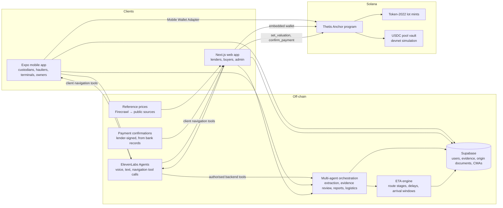
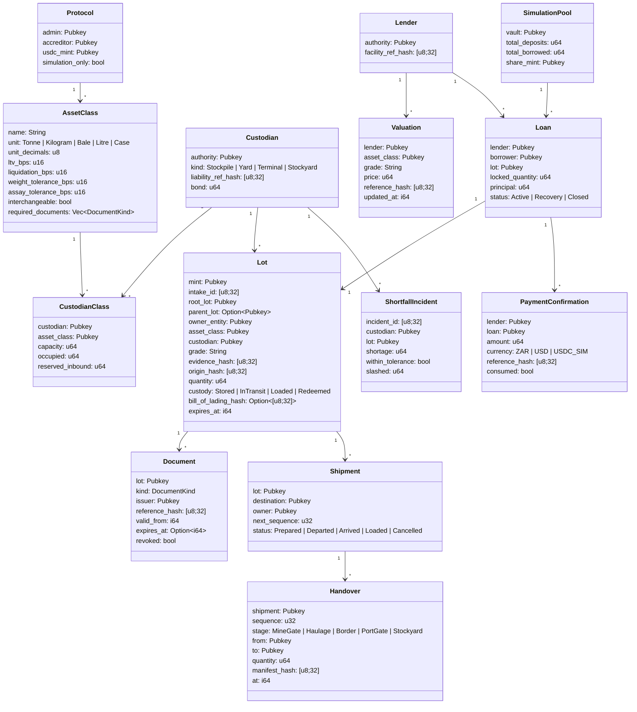
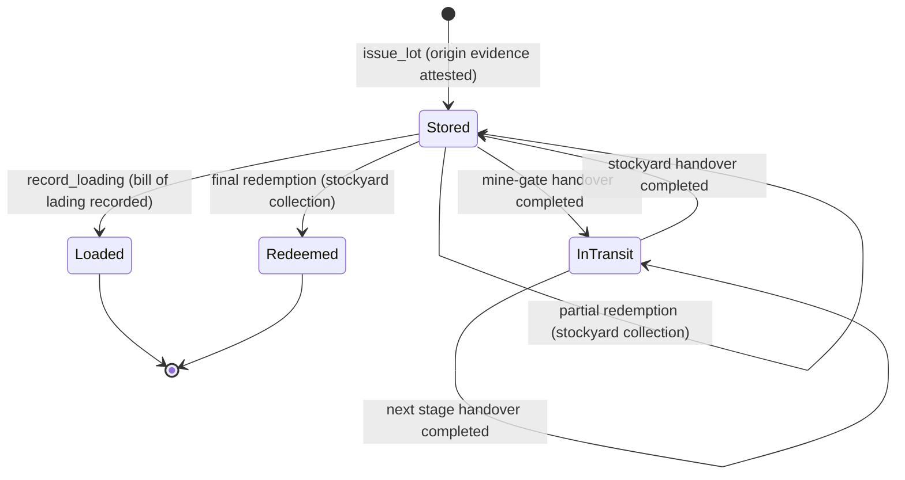

# Thetis — Revised Project Document

**Dev3Pack Global Hackathon · 27–29 November 2026 · Solana**
Revised 17 November 2026 · Working document

Builds on: [Project document](Thetis_Project_Document.md) (unchanged) · Business validation report: [original](Thetis%20Business%20Validation/reports/Thetis%20chrome%20finance%20validation%20%28Claude%20original%29.md) and [Codex revision](Thetis%20Business%20Validation/reports/Thetis%20chrome%20finance%20validation.md) · [Judgement review](Thetis_Judgement_Review.md) · [Cross-project enhancements](Thetis_Cross_Project_Enhancements.md) · [Design gap recommendations](Thetis_Design_Gap_Recommendations.md)

This revision narrows Thetis in response to the business validation research. It keeps the original engineering commitments (the Anchor program, two-signer handovers, document gates, ElevenLabs navigation, AI extraction, report versioning, ETA and the phased build) and changes who Thetis serves, where money moves, what the chain is for, and what the pitch claims. Any phase completed and verified by the submission deadline can go into the submission; how phases map onto the calendar is the team's decision.

**Two versions of the validation report.** This document was first built from the original report. Codex later revised that report in place, and the original is preserved alongside it. The two differ in their verdict: the original says "narrow"; the revision says "proceed with a narrower commercial validation target", and that this isn't a change of scope. Both point to the same first test: one exporter, one collateral manager, one lender, one inland route. On 17 November 2026 this document was checked against the revision. Where the revision is more cautious and better supported, this document follows it. The scope here is the team's revised design either way; the commercial case behind it is a hypothesis to test.

Labels used for evidence: **[Fact]** stated in a cited source · **[Inference]** reasoned from cited facts · **[Hypothesis]** needs primary evidence · **[Unknown]** no reliable source found.

> *Thetis changed shape until someone held on. We hold on to a financed lot through every hand it passes, from stockpile to truck to border to port.*

---

## 1. Summary

Thetis is a shared custody, pledge and release record for financed bulk minerals on the **inland leg from mine to port**, built on Solana. The pilot is South African chrome ore moving by road and rail to Richards Bay, Durban and Maputo.

- **Who it serves:** collateral managers and inspection firms, and the lenders who rely on them. They already finance stock by hand. The ore owner or exporter benefits through cheaper, faster access to finance, and fees likely pass through to them, as collateral-management fees do today.
- **What it does:** an independent custodian records a weighed, assayed lot with its origin evidence. A lender locks it as collateral, and the lock is visible to every other lender. Each handover between companies is signed by both parties. When part of the lot is sold and the lender confirms payment, one transaction releases the sold tonnes, reduces the debt and splits off the buyer's lot.
- **Where it stops:** at loading, the record hands over to the bill of lading, which is the document of title at sea. Thetis records the bill of lading's reference and retires the lot. Ore collected from a stockyard without being shipped, for example by a domestic buyer, leaves the record through a joint redemption instead.
- **Where money moves:** in production, through banks in rand or US dollars. The program acts on a lender's signed payment confirmation. The demo uses a USDC pool on devnet, clearly labelled as a simulation of the money flow.

The chain stays out of sight: users work in their own currency in a normal app, with wallets behind the login.

**The longer-term vision** remains the original one: any corridor, any bulk commodity, and eventually an open lending pool where the law allows it. It is presented as a vision, not as the business being validated.

## 2. The name

In Greek myth, Thetis was a sea nymph who changed shape again and again to escape Peleus. He held on through every form until she yielded. A financed lot does the same in Thetis: stockpile, truckload, border crossing, port stockyard. The record never lets go.

Thetis also rescued Hephaestus, the smith god, and later asked him to forge Achilles' armour, which links the name to metalwork. A search found no existing crypto project called Thetis. It sounds close to Theta Network, so say it clearly in the pitch.

## 3. The problem

### What is already served

Be clear about this in the pitch; judges in stage 2 will probe it.

- **[Fact]** South African banks already offer pre-export finance, borrowing-base facilities and inventory-backed lending, and FNB advertises finance for "materials in transit" ([FNB](https://www.fnb.co.za/business-banking/forex/trade-finance.html); [Absa](https://cib.absa.africa/corporate-banking/working-capital-trade-finance/)).
- **[Fact]** In March 2026 a listed chrome producer's trading arm replaced "more onerous and traditional" secured trade finance with about US$45m of unsecured pre- and post-shipment lines from HSBC and Absa ([IOL Business Report, 24 Mar 2026](https://iol.co.za/business-report/2026-03-24-tharisa-secures-45m-in-new-trade-finance-to-boost-chrome-trading-operations/)). Check the company's own announcement before quoting it. **[Inference]** Established producers have financing alternatives; whether they would still pay for better custody and release workflows is untested.
- **[Fact]** Some junior miners are funded by traders who also take their output, in some cases exclusively and for years. **[Inference]** Such agreements can leave no free ore for a third-party lender, but how common they are, and what the contracts actually restrict, is **[Unknown]** until real contracts are reviewed.

### The gap Thetis addresses

- **[Fact]** Lenders put goods in transit into borrowing bases, but keep that share "typically kept small" because of diversion, carrier liens and jurisdiction risk ([Mayer Brown, Sept 2023](https://www.mayerbrown.com/de/insights/publications/2023/09/mbitesize-goods-in-transit)).
- **[Fact]** Under a collateral management agreement, goods are released when the lender instructs or the debt is repaid: partial release exists, but as a manual instruction ([GTR, Understanding collateral management](https://www.gtreview.com/magazine/volume-16issue-2/understanding-collateral-management)).
- **[Fact]** After the 2020 trader collapses, banks were expected to be "particularly risk averse with smaller or localised traders" ([Daily Maverick/Bloomberg, 9 Jul 2020](https://www.dailymaverick.co.za/article/2020-07-09-after-9-billion-credit-hit-banks-seek-trade-finance-overhaul/)).
- **[Fact]** An estimated 10% of South African chrome output is mined illegally and enters the export chain, according to the Global Initiative ([GI-TOC Risk Bulletin 25, May–June 2022](https://riskbulletins.globalinitiative.net/esa-obs-025/03-emergence-of-bulk-commodity-illegal-industry-in-south-african-chrome-mining.html)). Undocumented stock is harder to lend against.
- **[Inference]** That leaves a niche: smaller exporters carrying their own stock along the inland road and rail leg, before a bill of lading exists, where lenders hold the least control.
- **[Unknown]** Whether any system already covers that leg. MineHub advertises shipment, assay and in-transit inventory tracking for metals ([MineHub](https://minehub.com/); [MineHub docs](https://docs.minehub.app/docs/tm/Reports/Physical-Position/)), and DMCC Tradeflow registers ownership of stored commodities for financing in the UAE ([DMCC](https://dmcc.ae/ecosystems/financial-services/tradeflow)). Both were added in the Codex revision. Compare them directly before claiming the inland leg is unserved.
- **[Unknown]** Whether this gap costs anyone enough to pay to fix it. **No source links chrome financing gaps to poor custody evidence.** This is the most important question for interviews (section 13).

### The pilot corridor: South African chrome

- **[Fact]** China took a record 12.5 million tonnes of South African chrome ore in 2025 ([SMM](https://news.metal.com/newscontent/103989945-smm-analysis-south-africas-chrome-ore-and-high-carbon-ferrochrome-exports)).
- **[Fact]** Congestion on Transnet's rail network and at Richards Bay has pushed volumes toward the Maputo corridor through Komatipoort ([Project Blue](https://projectblue.com/blue/news-analysis/1277/logistics-pressures-are-reshaping-chrome-export-patterns)).
- **Truck share — conflicting sources:** one industry estimate puts about 9 of 23.4 Mt of 2025 exports on trucks; secondary reporting citing Transnet data puts trucking at over 75% of ore and alloy movement to port ([Mining Weekly, 21 Feb 2024](https://www.miningweekly.com/article/mozambique-port-critical-to-chrome-exports-gets-upgraded-railway-link-2024-02-21)). Don't quote either figure as settled.
- **Export permit — not in force:** Cabinet approved export controls in June 2025 and ITAC proposed a permit regime in October 2025 ([ITAC](https://itac.org.za/government-initiates-control-measures-for-chrome-ore-exports-to-revitalise-local-industry/)). As of 13 October 2026 it had not been gazetted or enacted ([SMM, 13 Oct 2026](https://news.metal.com/newscontent/104155251-smm-chromium-analysis-south-africas-chrome-ore-exports-drop-108-in-august-chinas-share-reaches-70)). Recheck before the pitch.
- **[Unknown]** How long ore actually sits between mine and vessel, and what that costs in working capital. No source quantifies it.

## 4. What Thetis does

| Feature | What it means |
|---|---|
| **Lot records** | An accredited, independent custodian records a weighed, assayed lot: asset class, grade, quantity, custodian, expiry, and hashes of the weighbridge tickets, inspection certificate and assay. |
| **Origin evidence at intake** | Each lot carries the mining-right reference and an origin attestation. Chrome's documented integrity problem is illegal ore, so this is checked at intake, not only at departure. |
| **Independent custodians** | Sites controlled by the borrower can't act as custodian for that borrower's lots. A custodian's signature only counts as holding ore for a lender if it isn't the borrower. |
| **Duplicate and capacity checks** | Each intake ID is unique to its custodian and can't issue receipts twice. The program refuses to issue beyond a custodian's capacity for the asset class. |
| **Pledge lock visible to any lender** | A lender's lock covers an exact quantity. Every other lender can see it, and a second pledge of the same units is refused. |
| **Route-stage handovers** | Handovers are signed per route stage (mine gate, haulage, border, port gate, stockyard), each covering a manifest of trucks, not per truck. A 5,000-tonne lot is roughly 147 truckloads. Both parties sign the same transaction. |
| **Atomic partial release** | When the lender signs a payment confirmation, one transaction releases the sold tonnes, reduces the debt by at least enough to keep the remainder within its limit, and creates the buyer's unencumbered lot. |
| **Measurement tolerances** | Each asset class sets tolerance bands per measurement method. A shortfall within tolerance is recorded, never treated as a loss. |
| **Document gates** | Each asset class lists the documents a shipment needs, as configurable document kinds such as "export authorisation". Nothing claims the chrome permit is in force. |
| **Valuation** | The lender signs the valuation per grade that the program uses. Public reference prices are shown alongside. Stale or wrong-grade valuations block borrowing and release, never repayment or custody moves. |
| **Liability references** | Each custodian's record references its collateral management agreement and insurance by hash. Bond slashing remains an optional feature, not the main protection. |
| **Bill-of-lading hand-off** | At loading, the bill of lading's reference and hash are recorded and the lot is retired. The token never claims to be the document of title at sea. |
| **Stockyard collection (redemption)** | When ore leaves a stockyard without being shipped, for example to a local smelter or a domestic buyer, the holder and the custodian redeem it together. The collection weighbridge ticket is hashed, the redeemed units are burned, and the custodian's capacity is freed. Pledged units can't be redeemed until the lender releases them. |
| **Simulated pool (demo)** | A labelled devnet USDC pool simulates lender funding and repayment so the full flow can be shown on-chain. |

### Asset classes and receipt modes

- **Chrome ore** (lead) and **manganese ore** (second class with different settings) in the demo. Further classes are configuration.
- **Separate lots** apply on the inland leg, where a lot keeps its identity.
- **Interchangeable stock** (phase 6) applies where the physical reality is commingling. Port terminals probably mix ore of the same grade from different owners **[Hypothesis — verify with a terminal operator]**. If so, a lot arriving at the port stockyard becomes a share of that terminal's grade stock, with recorded lineage. This makes phase 6 relevant to chrome, not only to grain.

## 5. Users and roles

| Role | Who | Uses | Does |
|---|---|---|---|
| **First paying customer** [Hypothesis] | A collateral manager or inspection firm already working with chrome or bulk minerals in South Africa (for example SGS, Cotecna, Alfred H Knight's Richards Bay company, Steinweg, Global Collateral Control) | Mobile and web | Records lots and origin evidence, co-signs handovers and releases |
| **Gatekeeper** [Hypothesis] | The lender's credit and risk committee; the trade-finance desk operates day to day | Web | Locks collateral, signs valuations and payment confirmations, monitors exposure |
| **Beneficiary** [Hypothesis] | A small or mid-size independent exporter or trader carrying its own stock, not bound by an offtake, without unsecured lines | Mobile and web | Sees its lots, loans and releases; initiates shipments and sales |
| **Haulier** | Dispatch and drivers | Mobile | Co-signs stage handovers for a manifest |
| **Terminal** | Port gate and stockyard clerks | Mobile | Co-signs arrival; records loading and the bill of lading; acknowledges stockyard collections |
| **Buyer / trader** | Purchaser of part or all of a lot | Web | Receives its split lot after a release; ships it or collects it from the stockyard |
| **Accreditor** (admin) | Thetis operator | Web | Registers asset classes and accredits custodians, lenders and inspectors |

**[Inference]** A collateral manager will adopt only if its lender clients accept the record as monitoring evidence, so the lender is the real decision-maker. Under Basel's commodity-finance criteria lenders weigh legal control, insurance and the commodity's liquidity, and the research found no liquid hedge for chrome ([BCBS CRE33](https://www.bis.org/committees/bcbs/basel-framework/standard/cre/33/inforce/2019-12-15/published/2022-12-08)). The pitch must show that Thetis strengthens control evidence; it doesn't change chrome's liquidity.

## 6. Business model

**Thetis is a software platform. It does not lend.**

- **Who pays:** the collateral manager or the lender, per financed lot and per site, with the cost likely passed through to the borrower as collateral-management fees are today.
- **Why not lend:** in the research's illustrative model, a single 30% loss on one loan wipes out the net interest margin on about 122 loans. Balance-sheet lending also brings licensing and capital requirements Thetis can't meet.
- **Money flows in production:** rand or US dollars through a bank, Authorised Dealer or licensed crypto asset service provider. The program's release is triggered by an attested payment confirmation.

### Illustrative economics (all assumptions, from the validation report)

| Item | Figure | Status |
|---|---|---|
| Lot value | 5,000 t at about US$290/t (Tharisa's FY2026 average realised price, 42% concentrate CIF China) ≈ US$1.45m. CIF overstates value at the mine. | Price sourced; lot size assumed |
| Platform revenue per financed lot | About US$5,600 with loan-arrangement fees; about US$1,550 as a pure monitoring tool | Assumption |
| Lean five-person team | About US$0.26–0.33m a year | Assumption from published salary benchmarks |
| Break-even | 46–59 financed lots a year with arrangement fees; 168–213 as a pure tool | Assumption |
| Reachable initial market | About 23 kt a year in the pilot base case, roughly 4–5 lots; range from under one lot to about 30 | Assumption-driven funnel |

**[Inference]** Under these assumed prices, volumes and team costs, neither model pays at pilot scale. That isn't a verdict on every possible pricing or cost structure. The business case depends on more lots per customer, more custodians and lenders, and later more corridors and asset classes. Willingness to pay is **[Unknown]**: nobody has been asked.

### Fallback if lenders say no

If interviews show lenders won't accept the record as monitoring evidence, the fallback is **lawful-origin chain of custody**: provenance and compliance evidence for ore, which fits the documented pain of illegal mining and forged weighbridge slips. It is unproven, and the permit regime it would serve is not in force.

## 7. Legal and regulatory boundaries

These are findings from the validation research, not legal advice. Items marked for counsel need qualified South African (and, where relevant, Mozambican) legal advice before any production use.

| Area | Finding | Design response |
|---|---|---|
| **Security over ore** | **[Fact]** A pledge binds third parties only if the goods are delivered to the lender, actually, symbolically or by a custodian agreeing to hold them for the lender. A special notarial bond counts as a pledge only if the goods are "readily recognisable" (*Ikea v BOE*, 2004). | The token is never the security. A legal pledge or notarial bond sits alongside it. The custodian's co-signature is designed to evidence its agreement to hold for the lender. **[Counsel]** |
| **Token as document of title** | **[Fact]** No source treats a token as a document of title or valid pledge in South Africa, and no adoption of the UNCITRAL Model Law on Electronic Transferable Records was found for South Africa or Mozambique. | Present the lot record as evidence and control, not title. |
| **Sea leg** | **[Fact]** The bill of lading controls the goods once loaded (Carriage of Goods by Sea Act 1 of 1986, Hague-Visby Rules). | Hand off to the bill of lading at loading. |
| **Export proceeds** | **[Fact]** Exporters must receive the full foreign-currency proceeds within six months of shipment and offer them to an Authorised Dealer within 30 days ([SARB Currency and Exchanges Manual for Authorised Dealers, s B.18](https://www.resbank.co.za/content/dam/sarb/what-we-do/financial-surveillance/financial-surveillance-documents/2026/Currency%20and%20Exchanges%20Manual%20for%20Authorised%20Dealers.pdf)). | Production settlement through a USDC pool is not assumed. Proceeds go through a bank, and the program acts on the lender's payment confirmation. That confirmation is a trusted input: the bank payment and the on-chain release are separate events. The exact flows (where funds sit, who is resident where, conversion) need counsel and an Authorised Dealer. **[Counsel]** |
| **Stablecoins** | **[Fact]** The SARB is "unlikely to consider foreign currency-pegged stablecoins as payment instruments for domestic transactions" ([SARB–FSCA Joint Communication, May 2026](https://www.resbank.co.za/content/dam/sarb/what-we-do/payments-and-settlements/regulation-oversight-and-supervision/designation-notices/280526%20Joint%20Communication_Crypto%20assets%20for%20domestic%20payment%20purposes.pdf)). Draft crypto exchange-control rules are being redrafted after October 2026. | USDC only in the labelled devnet simulation until a compliant route exists. **[Counsel]** |
| **Foreign lenders** | **[Fact]** Loans from non-residents need Authorised Dealer approval and reporting (s I.3 of the same manual). | Production lending stays with licensed lenders. |
| **Crypto licensing** | **[Fact]** Crypto assets have been financial products under FAIS since October 2022; the FSCA licenses crypto asset service providers. | Whether receipts fall under crypto or securities rules is **[Unknown]**. **[Counsel]** |
| **Credit law** | **[Inference]** The National Credit Act probably doesn't apply to juristic borrowers with assets or turnover of at least R1m. | Serve business borrowers only. **[Counsel]** |
| **Lawful origin** | **[Fact]** A mining right is a limited real right (MPRDA s 5(1)); a receipt proves custody, not lawful title. | Origin evidence at intake (section 4). |
| **Mozambique** | **[Fact]** Security over movables is governed by Lei 19/2019 and Decreto 7/2020, with an electronic collateral registry operating since December 2021 ([VdA, 2019](https://www.vda.pt/xms/files/05_Publicacoes/2019/Flashes_Newsletters/Flash_VdA_Legal_Partners_-_Mocambique_-_Regime_Juridico_de_utilizacao_de_coisas_moveis_como_garantias_e_criacao_da_Central_de_Registo_de_Garantias_Mobiliarias.pdf)). Ore crosses at Ressano Garcia under a customs transit regime. | Where security must be registered in Mozambique, record the registration reference against the lot. **[Counsel]** |

**Regulatory route:** the Intergovernmental Fintech Working Group's guidance unit accepts written enquiries, which is a realistic first step for a student team ([IFWG FAQ](https://www.resbank.co.za/content/dam/sarb/quick-links/fintech/IFWG%20Frequently%20asked%20questions%20-%20updated.pdf)).

## 8. Why Solana

Solana is the shared record and the rule enforcement. It does nothing about the physical ore, the legal security or the rand.

| Job | How Solana does it | Why not a single company's database |
|---|---|---|
| **Custody record** | Each lot is an account; each stage handover is one transaction both parties sign through the QR flow | No single company has to be trusted to run the record when the custodian, haulier, terminal and lender are separate companies, in two countries |
| **Pledge lock visible to any lender** | One lock per quantity, readable by anyone | A collateral manager's database can't show a lender that another lender already holds the lot. Singapore built a central registry for trade-finance documents ([GTR](https://www.gtreview.com/news/fintech/monetago-picked-to-deliver-singapores-trade-finance-registry/)); Solana gives the check without an operator |
| **Atomic partial release** | Release, debt reduction and buyer split in one transaction | Today it is a manual instruction |
| **Receipts that obey rules** | Token-2022 receipts with transfer restrictions, confirmed by the token restriction spike | Rules hold even when someone bypasses the app |
| **Tamper-evident evidence** | Hashes of tickets, assays, origin documents and the bill of lading, timestamped per lot | Neither custodian nor borrower can quietly edit history |
| **Money, where lawful** | The devnet USDC pool simulation; production use waits for a compliant route | Lenders anywhere, settlement around the clock |

**When Solana matters:** once two parties who don't trust each other must write to the same record, with no operator both would accept. That happens with two competing custodians handling the same lot, two lenders who might finance the same stock, or custody crossing a border. A single collateral manager and its lenders could use a database. So Thetis is designed to give one customer value alone (atomic release and the evidence trail), and the shared-ledger case grows as a second custodian or lender joins. The demo shows two custodians from different companies and two lenders.

**Solana specifically:** a lot generates many co-signed events. Fees of a fraction of a cent and roughly second-long confirmation make signing at every stage practical on phones, and the Mobile Wallet Adapter puts signing on custodian staff phones.

## 9. Architecture



- **Anchor program (Rust):** everything that changes custody, locks or releases.
- **Expo mobile app:** intake with origin evidence, QR stage handovers, inspection and loading records. The entry for the Seeker prize.
- **Next.js web app:** lender locks, valuations and payment confirmations, exposure views, trading and admin.
- **Supabase:** users, roles, evidence files, origin documents and liability references. Hash the stored original, preserve it under an immutable identity, and bind each attestation to that identity and digest. Access is restricted to authorised users; only hashes go on-chain.
- **Valuation:** the lender signs a valuation per grade. Firecrawl collects public reference prices, such as producers' published realised prices, for display only. The main indices (Fastmarkets, Argus, Mysteel, SMM) are paywalled and are not scraped.
- **Settlement:** two adapters. The devnet simulation moves USDC in a labelled pool. The production path records a lender-signed confirmation that fiat payment arrived, with its reference hashed.
- **Money values:** integer minor units everywhere; each user's own currency shown at a quoted rate. No floating-point amounts in any layer.
- **Authentication:** login, wallet linking and session flow chosen by the team. A login never grants custody, lender or inspector authority.

### ElevenLabs conversational navigation and tool contracts

Unchanged in substance from the project document. Users can speak or type requests such as "open my shipment to Maputo", "show the missing documents for this lot", "take me to repayment" or "draft a delay report". ElevenLabs Agents calls registered tools to navigate and fetch context.

| Proposed tool | Execution | Behaviour |
|---|---|---|
| `navigate_to(screen, entity_id)` | Client | Opens an allowlisted screen or entity after checking access; no arbitrary URLs or code execution |
| `set_view_filters(view, filters)` | Client | Applies validated filters to shipment, lot or loan views |
| `prepare_form(form, entity_id, fields)` | Client | Opens a supported form with marked draft values; never submits an attestation or transaction |
| `get_lot_summary(lot_id)` / `get_shipment_status(shipment_id)` | Backend | Returns authorised current state, evidence references and freshness timestamps |
| `get_document_requirements(lot_id)` / `get_loan_status(loan_id)` | Backend | Returns deterministic requirements, missing items and calculated debt and health |
| `request_analysis(entity_id, analysis_kind)` | Backend | Dispatches an authorised extraction, dossier or logistics job and returns its job ID and status |

The data-handling rules in the project document apply unchanged: sensitive fields are validated, minimised and redacted server-side; navigation and permitted read-only lookups need no extra approval; spoken approval is never a wallet signature; agents cannot sign, attest or move value; touch and typed navigation remain available when audio or the agent service is unavailable.

### AI assistance, report versions and ETA

Unchanged from the project document. AI extraction proposes fields with page and image references; only an accredited human attests. The orchestrator routes extraction, evidence verification, dossier drafting and logistics explanation behind deterministic gates, with bounded retries and no signing authority. Report versions bind each lot dossier to a snapshot of evidence and chain records. The ETA engine produces arrival windows with uncertainty; delays trigger alerts, never automatic shortfalls.

One addition: extraction covers origin documents and bills of lading as well as assays and weighbridge tickets.

## 10. On-chain design

### Accounts



### Lot lifecycle

Custody and financing are tracked separately. This is the custody lifecycle:



Financing lives on the loan: active, in recovery, or closed. Pledging, releasing and repaying never change where the ore is. Once a lot is loaded, the lender's security continues through the bill of lading, outside Thetis.

### Rules the program enforces

The rules in the project document carry over (owner control, document validity, exact quantity locks, two-signer handovers, identity namespacing, retries, staleness, joint redemption). Changes and additions:

- **Independent custodians:** a custodian accredited as related to a borrower can't issue or hold lots for that borrower.
- **Origin evidence:** `issue_lot` requires an attested origin document for the asset class.
- **Cross-lender locks:** a lot's locked quantity is visible to all lenders, and `pledge` refuses units already locked by any lender.
- **Payment-confirmed release:** in production mode, `sell_pledged` and `repay` require an unconsumed payment confirmation from the loan's lender that covers the amount. Each confirmation is consumed once. In simulation mode, the devnet pool settles instead.
- **Lender valuations:** only the loan's lender can set the valuation it relies on. Stale or wrong-grade valuations block borrowing and release, never repayment or custody.
- **Stage handovers:** each handover names its route stage and the hash of its truck manifest. Stages must follow the shipment's route in order.
- **Tolerances:** a measured shortfall within the class's tolerance is recorded as within tolerance and can't slash a bond.
- **Loading:** `record_loading` requires the terminal's signature and the bill of lading hash, and needs every lock on the lot released or acknowledged by its lender.
- **Redemption:** `redeem` is the exit for ore collected without being shipped. It needs the holder's approval and the custodian's acknowledgement in one transaction, and neither can redeem alone. Only unlocked units of a Stored lot that isn't committed to a shipment can be redeemed, and the collection weighbridge ticket hash is recorded. Redeemed units are burned and the custodian's capacity is freed; a full redemption sets the lot to Redeemed, so it can't be pledged after the ore has left. For interchangeable stock, redemption draws from the grade stock earliest-expiry-first.

### Shipment from mine to port

```mermaid
sequenceDiagram
    participant O as Exporter
    participant C as Mine-site custodian (company A)
    participant H as Haulier
    participant B as Border agent
    participant P as Port terminal (company B)
    participant L as Lender
    participant T as Thetis program
    O->>T: prepare_shipment(lot, route, destination = P)
    T-->>T: check owner control, documents, origin, reserve capacity at P
    C->>H: mine-gate handover with manifest, signed by C (QR)
    H->>T: handover 1, signed by C and H
    H->>B: border handover, signed by H (QR)
    B->>T: handover 2, signed by H and B
    B->>P: port-gate handover, signed by B (QR)
    P->>T: handover 3, signed by B and P
    T-->>O: lot Stored at port, loan still locked
    L->>T: confirm_payment (buyer paid via bank)
    T-->>T: release sold tonnes, reduce debt, split buyer lot
    P->>T: record_loading(bill of lading hash)
    T-->>L: lot Loaded; security continues under the bill of lading
```

### Instructions

| Group | Instruction | Refused when |
|---|---|---|
| Setup | `register_class` | signer isn't the accreditor; invalid risk or tolerance settings |
| | `accredit_custodian` | signer isn't the accreditor; liability reference missing |
| | `accredit_lender` | signer isn't the accreditor; facility reference missing |
| | `post_bond` / `withdraw_bond` | withdrawal would leave the bond below required cover |
| Receipts | `issue_lot` | intake ID already used; origin document missing or invalid; custodian related to the borrower; over capacity; custodian not accredited for the class |
| | `transfer` / `split` | caller doesn't own the units; units locked; lot in transit or committed to a shipment; recipient not approved |
| | `redeem` (holder and custodian) | units locked by any lender; lot not Stored or committed to a shipment; missing the holder's approval or the custodian's acknowledgement; collection ticket hash missing; quantity exceeds the holder's units |
| Lending | `set_valuation` | signer isn't an accredited lender; timestamp older than the current one |
| | `pledge` | units not owned by the borrower; units already locked by any lender; lot expired or near expiry |
| | `borrow` (simulation) / `record_advance` (production) | over the loan-to-value limit; stale valuation |
| | `confirm_payment` | signer isn't the loan's lender; reference already used |
| | `repay` | no matching payment confirmation (production) or insufficient simulated funds; wrong loan |
| | `sell_pledged` | no matching payment confirmation (production); proceeds don't bring the remaining loan within its limit; buyer not approved; lot committed to a shipment |
| | `liquidate` | loan still healthy; stale valuation |
| | `deposit` / `withdraw` (simulation pool) | withdrawal exceeds free simulated liquidity |
| Custody | `prepare_shipment` | signer doesn't control the whole lot; required document invalid; lot not Stored; no capacity at the destination |
| | `handover` (two signers) | either signer isn't the current holder or the next party; stage out of order; manifest hash missing; final recipient isn't the reserved destination |
| | `cancel_shipment` | goods have already left the first custodian |
| | `record_loading` | signer isn't the terminal holding the lot; bill of lading hash missing; a lock remains unacknowledged |
| | `attest_document` / `revoke_document` | signer isn't authorised for that document kind |
| Enforcement | `attest_shortfall` | signer isn't an accredited inspector; incident ID already recorded; shortfall within tolerance (recorded, never slashed); slash would exceed the bond |

## 11. Demo (under three minutes)

The official rules require the video to be under three minutes and to show a real demo, not a pitch deck.

**Tagline:** "Every handover signed. No tonne financed twice."

**What the strongest rival demo set as the bar** (Heirloom, reviewed from a recorded judging session, 17 November 2026): a named persona and a human problem in the first 20 seconds; a voice agent answering questions from live data; an attack caught on screen; an on-chain receipt after every step; atomic settlement; a closing card with the stack and a live URL. Its closing line is "The AI recommends. The contract decides," so Thetis doesn't use that framing. Thetis should match the polish, and differ by showing what Heirloom can't: physical handovers between phones, and two lenders competing for the same tonnes.

### Running order (about 2:55)

| Time | Beat | On screen |
|---|---|---|
| 0:00–0:15 | **A person and a problem** | An illustrative independent chrome exporter has 5,000 tonnes waiting at a rail siding. Her bank keeps ore in transit to a small share of what it will lend against, and every partial release is a manual instruction. Label the persona and figures as illustrative; show one sourced line (Mayer Brown on small in-transit baskets). |
| 0:15–0:35 | **Intake** | On company A's custodian phone, the lot is weighed and assayed, its origin document attached and the lot recorded. Devnet receipt. |
| 0:35–0:50 | **Lock and advance** | Lender 1 locks the lot and advances finance, shown in rand, with "simulated money flow" on screen. Devnet receipt. |
| 0:50–1:10 | **The peak: no tonne financed twice** | Lender 2, from a different bank, tries to finance the same tonnes. The program refuses on lender 2's screen, and lender 1's screen shows its lock untouched. Caption: "Two banks, one record, no double financing." This is the "why not a database" moment. |
| 1:10–1:45 | **Ship** | Two phones meet at the mine gate: one shows a QR code, the other scans and signs, and the truck manifest is attached. A driver from another company tries to sign and is refused. At the border, the driver asks by voice, hands-free: "What's missing for this load?" The ElevenLabs agent answers from the record (documents attested, next stage, arrival window) and can't sign anything. Border to company B's port terminal. Devnet receipt per stage. |
| 1:45–2:10 | **Partial release** | A buyer pays for 2,000 tonnes through the bank. Lender 1 confirms payment, and one transaction releases the tonnes, reduces the debt and splits off the buyer's lot. Devnet receipt. |
| 2:10–2:20 | **Risk** | A labelled demo valuation drop moves the loan to its warning threshold. A voice or text question ("why is this loan amber?") gets a tool-backed explanation with the calculated figure. |
| 2:20–2:35 | **Loading** | The terminal records the bill of lading and the lot retires. Caption: the lender's security continues under the bill of lading. A note that a buyer can instead collect from the stockyard by joint redemption. |
| 2:35–2:45 | **A second attack** | A forged weighbridge ticket is uploaded at the port. Extraction reads it, and its details don't match the hashed ticket the custodian attested at intake, so it's flagged for review. This needs phase 8; until phase 8 is complete, show a reused intake ID being refused instead. |
| 2:45–2:55 | **Close** | The tagline; the stack (Solana, Anchor, Token-2022, Mobile Wallet Adapter, ElevenLabs, Firecrawl, Supabase); the live URL; the devnet program address; further corridors shown only as labelled configuration. If conversations were held, state how many and with which types of organisation. |

### Production rules

- **Real footage:** apart from the opening and closing cards, everything is the working app on phones and the web, not slides or mock-ups.
- **Receipts:** after each on-chain step, show the devnet transaction for a second or two, in the app or an explorer.
- **Refusals:** show each refusal on the screen of the party that was refused and, where relevant, on the screen of the party it protects.
- **Labels:** the persona, figures, valuation drop and money flow are labelled illustrative or simulated whenever they appear. Corridor facts come only from the pitch claim check (section 16).
- **Captions:** burn in captions so the video works without sound.
- **Voice:** use ElevenLabs where voice does a job a screen can't, such as the driver's hands-free question at the border, plus one explanation. Spoken requests never sign or attest.

## 12. Testing

Carry over the project document's test plan, with these additions:

- **Program:** cross-lender pledge refusal, related-custodian refusal, missing origin evidence, payment-confirmation reuse, stage order, manifest hashes, tolerance bands, loading with an unacknowledged lock, single-party and pledged-unit redemption, and pledging a redeemed lot.
- **Mode switching:** the same release journeys in production mode (payment confirmations) and simulation mode (devnet pool).

Aim for broad coverage of refusal paths and report it on the submission page. Don't pitch the count as a comparison with another team: stage 2 inspects code directly.

## 13. Validation plan

Desk research can't show demand, willingness to pay, custodian appetite or legal effect. These steps can. They are ordered; the team sets the dates.

1. **Correct the pitch facts:** the ITAC permit status, the truck-share conflict, and that "380+ projects from 89 countries" describes the May 2026 edition.
2. **Recheck volatile items before the pitch:** the export permit status, crypto exchange-control drafts, and the SARB rate decision of 19 November 2026.
3. **Hold 3–8 conversations across three segments**, using the interview guides in the validation report: a collateral manager or inspector, a lender's trade-finance desk, and an independent exporter or trader. Ask about their last real transaction, not whether they'd use Thetis. Report the conversations honestly in the submission. Organisation-level routes in the report include the Minerals Council's Junior and Emerging Miners' Desk, SGS, Cotecna's Richards Bay lab, Alfred H Knight's Richards Bay company, Grindrod's Matola terminal, and the ITFA African Regional Committee.
4. **Send one written enquiry** to the IFWG guidance unit about the receipt and payment design.
5. **Verify with a terminal operator** whether lots stay separate or are commingled by grade.
6. **After the hackathon, decide on a pilot** with one collateral manager and one lender, using the success and failure criteria in the validation report, or switch to the lawful-origin fallback if lenders reject the record.

**What would falsify the core hypothesis:** lenders saying custody evidence isn't why they decline or limit smaller exporters' stock, or that a shared record wouldn't change their in-transit limits.

## 14. Build phases

Phases are built in order; each ends with its tests passing. How they map onto the calendar is the team's decision. Any phase completed and verified by the deadline can go into the submission; unfinished capabilities stay disabled and are described as planned.

| Phase | Work | Done when |
|---|---|---|
| **0. Foundations** | Refine section 10 diagrams. Scaffold the repository with a shared types package, an open-source licence, and a README stating what was built before and during the event. Single verification gate. Token restriction spike. Identify public reference-price sources. Claim ledger. | The spike proves receipts can't be moved around the program's rules, or the program-controlled fallback is chosen |
| **1. Lot records** | Asset classes with tolerances, independent custodian accreditation with liability references, lender accreditation, intake IDs, origin evidence, capacity, lots, transfer, split with lineage, redemption by holder and custodian together; evidence integrity and private access. | Duplicate intake, missing origin, related custodian, over-capacity and single-party redemption are refused |
| **2. Locks, valuation and release** | Lender valuations, exact-quantity locks visible to all lenders, payment confirmations, debt-first partial release, repayment, liquidation into recovery; production and simulation settlement modes; labelled devnet pool. | A second lender's pledge is refused; a confirmation can't be used twice; both modes balance to the minor unit |
| **3. Custody in motion** | Shipment preparation, document gates, stage handovers with manifests, arrival, cancellation, loading with the bill of lading, shortfall incidents with tolerance bands. | A locked lot ships, arrives and loads with its lender's acknowledgement; wrong-party and out-of-order handovers are refused |
| **4. Apps and demo** | Expo app (intake, origin evidence, QR stage handovers, loading), Next.js app (locks, valuations, payment confirmations, exposure, admin), reference prices, ElevenLabs navigation and lookups, seeded demo with two custodians and two lenders including failure cases, demo video under three minutes, submission page. | A fresh environment reproduces section 11 and its refusals |
| **5. Hardening** | Versioned document policies with allowances across split lots, route changes after departure, shortfall disputes with a named resolution authority, recovery payout order. | Each rule has success and refusal tests |
| **6. Interchangeable stock** | Grade stock at port stockyards with lineage from arriving lots; earliest-expiry-first withdrawals; splitting for loading. | Quantity is conserved across arrival, merge, split and loading |
| **7. Evidence and full report versioning** | As in the project document. | As in the project document |
| **8. AI document extraction and multi-agent orchestration** | As in the project document, extended to origin documents and bills of lading. | As in the project document |
| **9. Advanced ETA and logistics** | As in the project document, by route stage. | As in the project document |

## 15. Positioning

**Lead with the mechanism and the gap, not the globe.** For example: "Thetis gives collateral managers and lenders a shared, signed record of a financed lot from mine stockpile to port, and releases sold tonnes in one transaction once the lender confirms payment."

**Official Dev3Pack judging** ([FAQ](https://hack.dev3pack.xyz/faq); the page renders answers with JavaScript, and this text was re-checked word for word in the site's FAQ script on 17 November 2026, which settles the provenance caveat in the Codex revision): "Two stages using Product and Technical rubrics. Stage 1: All submissions are scored and filtered to the top 100. Stage 2: The top 100 receive a deeper review, including code inspection, founder-market fit, and live demo verification. Key signals include eligibility compliance, product clarity, real-world impact, demo quality, deployment, repo quality, and Solana/SDK depth." No weights are published.

| Signal | How revised Thetis answers it |
|---|---|
| Solana/SDK depth | Anchor accounts, Token-2022 receipts, two-signer transactions, Mobile Wallet Adapter, atomic release |
| Real-world impact | A sourced gap (small in-transit baskets, manual releases, illegal ore), stated honestly with its unknowns |
| Founder-market fit | The weakest signal for a student team; documented conversations are the main lever |
| Product clarity and demo | One flow, two custodians, two lenders, one refusal that shows why a shared ledger matters |
| Eligibility and repo | Open source, a README separating earlier and new work, a video under three minutes, devnet addresses |

**Prizes and sponsors:**
- **Best App Overall:** depth of the program and a credible, narrow business.
- **Best Mobile App (Seeker phones):** custodians, hauliers and terminals sign on phones.
- **ElevenLabs:** conversational navigation and tool-backed explanations.
- **Firecrawl:** public reference prices. **Supabase:** evidence and records.

**Main rival:** last edition's top South African entry was agri-finance for smallholders; its builder has since won W3Node with Heirloom. Thetis stays out of both areas and competes on depth, originality and an honest, researched business case.

## 16. Pitch claim check

| Claim | Safe to use? |
|---|---|
| China took 12.5 Mt of South African chrome ore in 2025 | Yes, with the SMM source |
| Lenders keep in-transit stock baskets small | Yes, with the Mayer Brown source |
| Partial releases are manual instructions under collateral management agreements | Yes, with the GTR source |
| About 10% of chrome output is mined illegally | Yes, as the Global Initiative's 2022 estimate |
| Chrome exports need an ITAC permit | **No.** Proposed, not gazetted as of 13 October 2026 |
| About 9 of 23.4 Mt goes by truck | **No.** Sources conflict |
| Delays tie up miners' working capital | **No.** Unsourced; present as a question |
| 380+ projects from 89 countries | Only as "the May 2026 edition drew…" |
| The token secures the loan | **No.** Legal security is a pledge or notarial bond alongside it |
| Thetis is faster than a bank release | Only as a design property; no measured comparison exists |
| A listed producer swapped secured trade finance for US$45m of unsecured lines | Yes, after checking the company's own announcement; as one producer's example, not a market trend |
| Chrome averaged US$290/t CIF China in FY2026 | Only attributed to that one producer, after reading the full source; it isn't an index |
| No system covers the inland leg | **No.** Not established; MineHub and DMCC Tradeflow need direct comparison |
| Dev3Pack judges in two stages on Product and Technical rubrics | Yes, quoting the FAQ; no weights are published |

Both versions of the validation report carry a full claim ledger with sources, dates and evidence quality. The Codex revision is stricter about which claims are ready for the pitch; use its verdicts where the two differ.

## 17. Open items

- **Team:** size (1–4 allowed) and the split between program, mobile and web.
- **Repository location:** not yet decided.
- **Legal advice:** whether a custodian's signature can serve as its agreement to hold for the lender; receipts under crypto or securities rules; Mozambican registration; the production payment route.
- **Terminal commingling:** confirm with an operator.
- **Willingness to pay:** unknown until interviews.
- **Custodian liability appetite:** whether collateral managers accept liability for co-signed stages.
- **Reference prices:** confirm usable public sources.
- **Token restriction spike:** as in phase 0.
- **Authentication flow and AI implementation choices:** as in the project document.

## Sources

- [Dev3Pack FAQ](https://hack.dev3pack.xyz/faq)
- [SMM: South Africa's chrome ore and ferrochrome exports](https://news.metal.com/newscontent/103989945-smm-analysis-south-africas-chrome-ore-and-high-carbon-ferrochrome-exports)
- [SMM, 13 Oct 2026: chrome ore exports and permit status](https://news.metal.com/newscontent/104155251-smm-chromium-analysis-south-africas-chrome-ore-exports-drop-108-in-august-chinas-share-reaches-70)
- [ITAC: control measures for chrome ore exports](https://itac.org.za/government-initiates-control-measures-for-chrome-ore-exports-to-revitalise-local-industry/)
- [Project Blue: logistics pressures reshaping chrome export patterns](https://projectblue.com/blue/news-analysis/1277/logistics-pressures-are-reshaping-chrome-export-patterns)
- [Mining Weekly, 21 Feb 2024: Mozambique port and trucking share](https://www.miningweekly.com/article/mozambique-port-critical-to-chrome-exports-gets-upgraded-railway-link-2024-02-21)
- [IOL Business Report, 24 Mar 2026: Tharisa trade finance](https://iol.co.za/business-report/2026-03-24-tharisa-secures-45m-in-new-trade-finance-to-boost-chrome-trading-operations/)
- [FNB trade finance](https://www.fnb.co.za/business-banking/forex/trade-finance.html) · [Absa working capital and trade finance](https://cib.absa.africa/corporate-banking/working-capital-trade-finance/)
- [Mayer Brown, Sept 2023: goods in transit](https://www.mayerbrown.com/de/insights/publications/2023/09/mbitesize-goods-in-transit)
- [GTR: Understanding collateral management](https://www.gtreview.com/magazine/volume-16issue-2/understanding-collateral-management)
- [Daily Maverick/Bloomberg, 9 Jul 2020: banks and smaller traders](https://www.dailymaverick.co.za/article/2020-07-09-after-9-billion-credit-hit-banks-seek-trade-finance-overhaul/)
- [GI-TOC Risk Bulletin 25: illegal chrome mining](https://riskbulletins.globalinitiative.net/esa-obs-025/03-emergence-of-bulk-commodity-illegal-industry-in-south-african-chrome-mining.html)
- [BCBS CRE33: commodity finance slotting criteria](https://www.bis.org/committees/bcbs/basel-framework/standard/cre/33/inforce/2019-12-15/published/2022-12-08)
- [SARB Currency and Exchanges Manual for Authorised Dealers (2026)](https://www.resbank.co.za/content/dam/sarb/what-we-do/financial-surveillance/financial-surveillance-documents/2026/Currency%20and%20Exchanges%20Manual%20for%20Authorised%20Dealers.pdf)
- [SARB–FSCA Joint Communication on crypto assets for domestic payments, May 2026](https://www.resbank.co.za/content/dam/sarb/what-we-do/payments-and-settlements/regulation-oversight-and-supervision/designation-notices/280526%20Joint%20Communication_Crypto%20assets%20for%20domestic%20payment%20purposes.pdf)
- [VdA, 2019: Mozambique movable collateral regime and registry](https://www.vda.pt/xms/files/05_Publicacoes/2019/Flashes_Newsletters/Flash_VdA_Legal_Partners_-_Mocambique_-_Regime_Juridico_de_utilizacao_de_coisas_moveis_como_garantias_e_criacao_da_Central_de_Registo_de_Garantias_Mobiliarias.pdf)
- [GTR: MonetaGo and Singapore's Trade Finance Registry](https://www.gtreview.com/news/fintech/monetago-picked-to-deliver-singapores-trade-finance-registry/)
- [IFWG FAQ](https://www.resbank.co.za/content/dam/sarb/quick-links/fintech/IFWG%20Frequently%20asked%20questions%20-%20updated.pdf)
